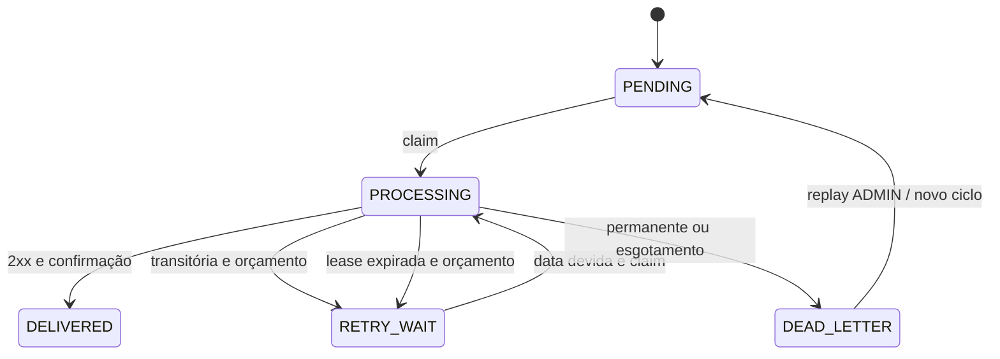

# FDD — Webhooks de mudança de status de pedidos

**Data:** 17/11/2026 · **Status:** proposta técnica para revisão · **Entrega:** documentação, sem implementação.

## 1. Contexto e motivação técnica

O monólito modular TypeScript/Express expõe `/api/v1`, usa Prisma/MySQL e compõe dependências manualmente. `OrderService.changeStatus` transaciona leitura do pedido, validação, estoque aplicável, atualização de status e histórico. Débito ocorre apenas em `PENDING → PAID`; cancelamento de `PAID/PROCESSING` repõe estoque. Não existem módulo webhook, outbox, worker, DLQ ou cliente HTTP de entrega no código inspecionado.

Os clientes B2B querem substituir consultas periódicas por notificações outbound. O commit deve assegurar a intenção de entrega, sem depender da disponibilidade do consumidor e sem HTTP dentro da transação de negócio. A [RFC](RFC.md) define o que será feito; este documento especifica como.

### 1.1. Fontes, status e conflitos

Foram lidos integralmente a [transcrição](../TRANSCRICAO.md), a RFC, os sete ADRs e os relatórios técnicos relevantes da seção 16; os pontos de integração foram conferidos diretamente no código. Os relatórios ficam em `docs/reports/`, não em `reports/` na raiz. O FDD anterior continha somente título e comentário de documento a elaborar.

**Existente** indica código confirmado; **reunião**, requisito verbal; **proposta ADR/FDD**, desenho sujeito a revisão. Todos os ADRs e a RFC estão propostos: este documento não os promove a aceitos. Salvo indicação de origem, detalhes de implementação abaixo são propostas FDD. Não há comprovação de implantação ou desempenho nesta investigação estática.

| Conflito/lacuna | Tratamento |
|---|---|
| “Total 5 tentativas” e cinco esperas na reunião | Aplicar um envio inicial e até quatro retentativas. O intervalo de 12 h permanece em revisão no ADR-007. |
| Um worker não resolve ordem durante retry | Proposta ADR-004/006 bloqueia sucessores por pedido/endpoint até sucesso/DLQ. Replay pode chegar fora de ordem. |
| Cliente inicialmente sugerido no JWT e depois corrigido | `customerId` explícito; JWT atual contém usuário/role, sem vínculo com Customer. Isolamento pendente. |
| Reunião sugere middleware sem mudanças | Envelope é reutilizável, mas códigos de auth/Zod/Prisma são genéricos; adaptar localmente para `WEBHOOK_`. |
| Timestamp sugerido como proteção de replay | ADR-005 assina só corpo; timestamp do header não é autenticado. Deduplicação continua obrigatória. |
| Polling 2s interpretado como limite de latência | É intervalo de busca; backlog, duração HTTP e bloqueio de ordem podem superar 10s. |

## 2. Objetivos técnicos

1. Confirmar evento e todas as entregas elegíveis no mesmo commit de status/histórico/estoque; falha de enqueue reverte tudo.
2. Executar HTTP em processo separado, com polling de 2s e timeout total de 10s por chamada, conforme reunião.
3. Preservar UUID e bytes do snapshot em retries/replay; permitir reconhecimento de duplicatas por `(webhookId,eventId)`.
4. Assinar os bytes transmitidos com HMAC-SHA256 e segredo por endpoint, com coexistência de 24h na rotação.
5. Persistir agendamento, tentativas e falhas terminais; recuperar trabalho abandonado sem perder intenção confirmada.
6. Rastrear origem, processamento e entrega sem expor segredos; manter contratos e regras atuais de pedidos.
7. Medir meta de notificação abaixo de 10s em cenário saudável e carga acordada. Retry/replay e bloqueios devem ser medidos separadamente.

At-least-once admite repetição e recuperação de intenção durável. Retry finito seguido de DLQ não promete recepção por destino permanentemente indisponível.

## 3. Escopo e exclusões

**Dentro:** CRUD por cliente, filtro de status na emissão, geração/rotação de segredo, snapshot de `order.status_changed`, evento compartilhado com entregas independentes, worker separado, HTTP assinado, retry, DLQ separada, replay ADMIN auditado e histórico paginado. Alterações futuras: schema/migração, composição, configuração, scripts, instrumentação e integração em `changeStatus`.

**Fora:** inbound, eventos de criação/exclusão de pedidos, itens no payload, email, dashboard, Redis/broker, exactly-once, ordenação global, escala com múltiplos workers, rate limiting de saída e rotina de arquivamento. “30 dias ou assim” não constitui política de retenção. Não criar endpoints de teste ou listagem global de DLQ apenas para ampliar contratos; investigação operacional usará histórico e consulta controlada ao banco.

## 4. Desenho técnico da solução

### 4.1. Componentes propostos

Todos os caminhos abaixo **serão criados**, não existem atualmente. Seguir classes, injeção manual, imports ESM `.js`, handlers com `next(err)` e schemas Zod do projeto, sem container de DI, barramento ou repository genérico.

| Caminho proposto | Responsabilidade/símbolos |
|---|---|
| `src/modules/webhooks/webhook.routes.ts` | `buildWebhookRouter` e router admin; autenticação, schemas e erros locais. |
| `src/modules/webhooks/webhook.controller.ts` | `list/create/update/delete/rotateSecret/deliveries/replay`, DTOs explícitos e status HTTP. |
| `src/modules/webhooks/webhook.schemas.ts` | UUID, URL, status, bodies estritos, paginação e adaptação de validação. |
| `src/modules/webhooks/webhook.service.ts` | Configuração, rotação e replay transacional; nunca entrega HTTP. |
| `src/modules/webhooks/webhook.repository.ts` | Consultas, claim e finalização; operações transacionais recebem `Prisma.TransactionClient`. |
| `src/modules/webhooks/webhook.publisher.ts` | `publishWebhookEvent(tx,order,fromStatus,toStatus,sequence,context)`; filtra e insere no tx recebido. |
| `src/modules/webhooks/webhook.processor.ts` | Seleção, tentativa, classificação e recuperação; transporte/relógio injetáveis para testes. |
| `src/modules/webhooks/webhook.security.ts` | Secret, cifragem, HMAC, URL/DNS/SSRF usando APIs Node. |
| `src/modules/webhooks/webhook.errors.ts` | Subclasses AppError e adaptadores locais. |
| `src/worker.ts` | Bootstrap independente, loop, Prisma/Pino e shutdown. |

Publisher faz I/O transacional, portanto não é função pura no sentido matemático, apesar da expressão informal da reunião. Sua propriedade obrigatória é usar exclusivamente o `tx` recebido, sem outro cliente/transação e sem rede.

### 4.2. Modelo de dados proposto

Propriedades camelCase, tabelas snake_case via `@@map`, UUID `CHAR(36)`, contadores Int não negativos, datas UTC com milissegundos e enums Prisma, seguindo convenções existentes. Não são tabelas já implantadas.

| Modelo/tabela | Campos e constraints |
|---|---|
| `WebhookEndpoint` / `webhook_endpoints` | `id`, `customerId` FK Customer RESTRICT, `url` VARCHAR(2048), `urlHash` CHAR(64), `active` default true, `statuses` JSON de OrderStatus, `secretCiphertext` TEXT nullable apenas após remoção, `secretVersion` Int, `previousSecretCiphertext` nullable, `previousSecretExpiresAt` nullable, `deletedAt` nullable, `createdAt`, `updatedAt`. UNIQUE `(customerId,urlHash)`. |
| `WebhookEvent` / `webhook_events` | `id`=event_id, `orderId`, `customerId`, `sequence` Int, `eventType`, `occurredAt`, `payloadText` LONGTEXT, `payloadBytes`, `requestId/traceId` nullable. UNIQUE `(orderId,sequence)`. Snapshot imutável; IDs de negócio copiados sem FK para não impedir exclusão de pedido nem apagar evidência em cascata. |
| `WebhookOutbox` / `webhook_outbox` | `id` identidade da entrega, `eventId` FK Event RESTRICT, `webhookId` FK Endpoint RESTRICT, `state`, `cycle` default 1, `attemptCount` default 0, `nextAttemptAt`, `leaseToken/leaseExpiresAt` nullable, `lastErrorCode` nullable, `deliveredAt` nullable, `createdAt/updatedAt`. UNIQUE `(eventId,webhookId)`. |
| `WebhookDeliveryAttempt` / `webhook_delivery_attempts` | `id`, `outboxId` FK RESTRICT, `cycle`, `number`, `state` STARTED/SUCCEEDED/FAILED/UNKNOWN, `startedAt`, `finishedAt/durationMs/httpStatus/errorCode/responseBody` nullable, `responseTruncated`, `destinationUrl`, `secretVersion`, `leaseToken`. UNIQUE `(outboxId,cycle,number)`. |
| `WebhookDeadLetter` / `webhook_dead_letter` | `id`, `outboxId` FK RESTRICT, `cycle`, `payloadText` cópia exata, `failureCode`, `causeCode`, `lastHttpStatus` nullable, `failureReason` sanitizada, `failedAt`, `replayedAt/replayedById/replayRequestId/replayCycle` nullable. UNIQUE `(outboxId,cycle)`. Autor UUID copiado para preservar auditoria sem bloquear exclusão de usuário. |

`Order` recebe `statusVersion Int @default(0)`, incrementada a cada transição válida, inclusive sem inscritos, para sequência monotônica por pedido (proposta ADR-006). Lacunas são normais; não usar UUID ou `changedAt` para ordenar transições concorrentes.

Guardar payload como string serializada uma única vez; coluna JSON poderia alterar representação ao reserializar. Validar `Buffer.byteLength(payloadText,'utf8') <= 65536`: interpretação proposta de 64 KB como 64 KiB, a confirmar. Não truncar snapshot. `statuses` tem até seis valores; consultar endpoints por cliente/ativo e filtrar em memória no tx, sem índice JSON prematuro.

Índices: Endpoint `(customerId,active,deletedAt)`; Event UNIQUE `(orderId,sequence)`; Outbox `(state,nextAttemptAt,createdAt,id)`, `(state,leaseExpiresAt)`, `(webhookId,eventId,state)`; Attempt `(outboxId,startedAt,id)`; DLQ `(failedAt,id)` e `(replayedAt,failedAt)`, além das constraints únicas. Validar plano de join para predecessores no MySQL real antes de rollout.

Normalizar URL com parser WHATWG, host minúsculo/porta padrão removida e path/query preservados; proibir fragmento/userinfo. SHA-256 da URL normalizada evita índice longo e comparação de path sem distinção de caixa pela collation atual. Proposta: reservar unicidade mesmo após remoção lógica até política de retenção; comparar URL em colisão e retornar conflito seguro. Essa semântica requer validação.

### 4.3. Estados, transações e concorrência

Outbox: `PENDING → PROCESSING → DELIVERED`; falha transitória `PROCESSING → RETRY_WAIT → PROCESSING`; permanente/esgotada `→ DEAD_LETTER`; replay `DEAD_LETTER → PENDING`, incrementando ciclo. Estados terminais são DELIVERED e DEAD_LETTER. Lease expirada habilita recuperação, sem novo envio se orçamento terminou.

Na transação de `changeStatus`, antes da leitura, executar `SELECT id FROM orders WHERE id = ... FOR UPDATE` via `tx.$queryRaw` parametrizado; depois reler pedido/itens, validar transição, movimentar estoque, atualizar status/version, inserir histórico e publicar. Serializar mudanças do mesmo pedido impede evento com origem/sequência incorretas. Deadlock/timeout aborta toda a operação; não repetir automaticamente mutação HTTP sem contrato de idempotência. Isso não resolve corrida de estoque entre pedidos distintos: risco preexistente exige trabalho próprio.

Claim: selecionar `PENDING/RETRY_WAIT` devidos ou PROCESSING com lease expirada, sem predecessor automático não terminal de sequência menor para `(orderId,webhookId)`. Bloqueio histórico considera ciclos originais (`cycle=1`); replay não recompõe ordem. Ordenar candidatos `(createdAt,id)`. Para cada candidato, transação curta bloqueia Outbox, relê estado/data/orçamento/predecessores e Endpoint, atribui UUID de lease e expiração de 60s (proposta ADR-006), incrementa contador e grava Attempt STARTED. Endpoint indisponível vai à DLQ sem chamada. SQL adicional deve ser parametrizado; nunca concatenar entrada.

HTTP somente após commit do claim, sem lock transacional. Reivindicar imediatamente antes de enviar, não reservar lote inteiro. Inicial: um worker e um envio por vez; batch sugerido 20 candidatos, sujeito a capacidade. Locks protegem sobreposição acidental, não autorizam escala.

Finalizar em tx condicionada a `id + leaseToken + state=PROCESSING + leaseExpiresAt > NOW(3)`, gravando Attempt e Outbox/DLQ juntos. Token antigo não confirma nem altera DLQ. Usar horário do banco para agendamento/lease. Recuperação transforma STARTED abandonada em UNKNOWN, consumindo orçamento porque envio pode ter ocorrido. Falha de banco/claim não autoriza reenvio imediato em memória.

## 5. Fluxos detalhados

### 5.1. Criação do evento na Outbox

1. Rota existente `PATCH /api/v1/orders/:id/status` chega ao `OrderController.changeStatus` e serviço com usuário/input.
2. Após lock/releitura no tx, preservar `canTransition`, `shouldDebitStock` e `shouldReplenishStock`. Mesmo status/transição inválida não gera evento.
3. Atualizar status/version e histórico. Publisher lê, no mesmo tx, endpoints do customer não removidos, ativos e interessados no `toStatus`.
4. Sem interessados: zero Event/Outbox. Com N interessados: um UUID v4 de domínio, timestamp UTC e snapshot; inserir Event e N Outbox PENDING com UUID próprio, contador zero, ciclo 1 e data atual.
5. Tamanho acima do limite: proposta de `WEBHOOK_PAYLOAD_TOO_LARGE` 422 com rollback integral, sem truncamento. Consequência sobre negócio ainda depende de validação da RFC.
6. Qualquer falha necessária ao enqueue impede commit de pedido/histórico/estoque/eventos. Preservar retorno atual do pedido. Não emitir em `create`, seed ou escrita direta Prisma.

```mermaid
sequenceDiagram
    participant C as Cliente
    participant O as OrderService
    participant DB as MySQL
    participant W as Worker
    C->>O: changeStatus
    O->>DB: BEGIN; lock pedido; reler/validar
    O->>DB: estoque aplicável + status/version + histórico
    O->>DB: filtrar inscritos e inserir evento/entregas
    alt falha
        O->>DB: ROLLBACK
        O-->>C: erro, sem efeitos parciais
    else sucesso
        O->>DB: COMMIT
        O-->>C: 200 pedido atualizado
        W->>DB: polling e claim após commit
    end
```

### 5.2. Processamento pelo Worker

Bootstrap valida ambiente, conecta Prisma uma vez e usa logger filho `component=webhook-worker,workerId`. Não chamar `buildApp/listen`. Scripts futuros: `worker: tsx --env-file=.env src/worker.ts` e `worker:start: node --env-file=.env dist/worker.js` após build; não existem ainda.

Loop sem sobreposição faz polling a cada 2s ocioso, recupera leases e processa candidatos um a um. Após trabalho, busca devidos sem acumular timers concorrentes. Prepara bytes originais e destino/segredos vigentes lidos consistentemente no claim; valida/fixa DNS seguro imediatamente antes de conectar. Assina e faz POST HTTPS sem redirect. Timeout total de 10s inclui DNS/conexão/resposta/leitura limitada; abortar socket ao vencer prazo.

Qualquer 2xx confirma entrega, inclusive 204 sem body; não exigir JSON de confirmação. Persistir resultado/duração/resposta sanitizada junto ao estado. HTTP nunca fica dentro do tx de claim/finalização.

SIGINT/SIGTERM interrompem claims, aguardam tentativa/finalização em curso e desconectam Prisma. Prazo sugerido 15s, a validar; se excedido, abortar HTTP e deixar recuperação por lease. Não copiar `process.exit` imediato do servidor atual.

### 5.3. Retry

Proposta ADR-007: timeout, rede/DNS transitório e HTTP 408/429/5xx permitem retry; 2xx é sucesso; outros HTTP, inclusive 3xx/401/403/404/410/422, são permanentes. TLS inválido, URL bloqueada e snapshot inválido são permanentes de segurança/dados. Sem redirect e sem retry oculto do transporte.

| Chamada automática por ciclo | Após falha recuperável | Espera até próxima |
|---|---|---|
| 1 inicial | RETRY_WAIT | 60s |
| 2 | RETRY_WAIT | 300s |
| 3 | RETRY_WAIT | 1800s |
| 4 | RETRY_WAIT | 7200s |
| 5 | DEAD_LETTER | nenhuma |

O ciclo tem **cinco tentativas totais**, incluindo o envio inicial. As quatro esperas operacionais seguem os primeiros intervalos citados. O intervalo de 12 h permanece em revisão. `nextAttemptAt = conclusão no banco + delays[attemptCount-1]` somente quando a falha for recuperável e attemptCount < 5; tabela fixa, não fórmula exponencial aproximada. Soma de esperas: 2h36, além de chamadas/polling. Sem jitter inicialmente; introdução exige revisão. `Retry-After` pode ser diagnosticado mas não altera tabela nesta proposta.

Contagem ocorre no claim; UNKNOWN também consome orçamento. Ao recuperar lease expirada, uma transação condicionada ao token anterior conclui STARTED como UNKNOWN, limpa lease e agenda RETRY_WAIT usando a espera correspondente ao contador já consumido, a partir do horário da recuperação no banco. O novo claim só ocorre quando essa data vencer. Se a última chamada for abandonada, recuperar para DLQ com causa desconhecida, sem sexta chamada. Não dormir horas no processo: persistir data, liberar loop. Retries mantêm evento/payload/ciclo. Sucessores automáticos do mesmo pedido/endpoint aguardam inclusive em backoff; outros destinos/pedidos seguem.

### 5.4. DLQ e replay

Falha permanente/esgotamento conclui Attempt, insere DLQ única por entrega/ciclo com payload/motivo/data e marca Outbox DEAD_LETTER **no mesmo tx**. Outbox terminal é preservada para integridade/histórico e excluída do polling. Falha nessa escrita não deixa estado parcial: lease recuperará, com risco conhecido de duplicata.

Histórico retorna `deadLetterId`; operação investiga via consulta restrita ao banco, sem painel novo. ADMIN faz replay bloqueando DLQ/Outbox: verificar registro não reprocessado, endpoint ativo/não removido e ciclo terminal; mesma Outbox volta PENDING, `cycle+1`, contador zero, sem lease e data atual. Registrar autor, requestId, horário e novo ciclo na DLQ atomicamente. Preservar event_id e bytes; não reaplicar filtro de status atual à recuperação manual.

Dois replays da mesma DLQ: um 202, outro 409. Nova falha produz outra DLQ por ciclo; apenas essa nova origem pode ser reprocessada novamente. Não apagar tentativas antigas. Replay pode chegar depois de eventos recentes e não significa entrega concluída.



## 6. Contratos públicos

### 6.1. Convenções comuns

Os **sete endpoints administrativos abaixo são propostas de paths/DTOs** para operações da reunião, não rotas existentes. Base `/api/v1` real; camelCase administrativo conforme código; outbound snake_case conforme reunião.

Todos exigem `Authorization: Bearer <JWT>`; CRUD, histórico e rotação admitem ADMIN/OPERATOR; replay adiciona `requireRole('ADMIN')`. Não há vínculo User–Customer no schema: comportamento compatível atual permite indicar qualquer customerId. **Não existe isolamento B2B comprovado.** Definir vínculo/escopo antes de exposição externa, sem inventá-lo como componente existente.

Quando houver JSON, `Content-Type: application/json` obrigatório; `Accept: application/json` e `X-Request-Id` opcionais. Responses JSON têm Content-Type; X-Request-Id é refletido/gerado. Criação/rotação: `Cache-Control: no-store`. IDs UUID; paginação `page>=1,pageSize=1..100`, padrões 1/20, como orders. Campos desconhecidos são rejeitados. Sem params/query/body além dos explicitados.

Erros comuns de cada endpoint: 400 `WEBHOOK_VALIDATION_ERROR` (params/query/body), 401 `WEBHOOK_UNAUTHORIZED`, 403 `WEBHOOK_FORBIDDEN` quando acesso negado, 500 `WEBHOOK_PERSISTENCE_FAILED` para armazenamento conhecido; falhas inesperadas globais continuam `INTERNAL_SERVER_ERROR`. Com JSON: 400 JSON inválido, 413 entrada acima de 1 MB e 415 mídia incompatível, adaptação da seção 7. Erros adicionais são listados por operação. Envelope comum e exemplo completo:

```json
{"error":{"code":"WEBHOOK_VALIDATION_ERROR","message":"Dados inválidos","details":[{"path":"statuses","message":"Informe status sem duplicatas"}]}}
```

Requests completos abaixo omitem apenas token real/comprimento calculado pelo cliente. UUIDs/secrets são fictícios. GET e DELETE são enviados sem body e dispensam Content-Type. Cadastro, edição, rotação e replay exigem body JSON.

### 6.2. POST /api/v1/webhooks — cadastrar

Sem path/query. Body: `customerId` UUID existente; `url` HTTPS segura até 2048 caracteres; `statuses` array de 1..6 valores únicos do enum `PENDING,PAID,PROCESSING,SHIPPED,DELIVERED,CANCELLED`; `active` boolean opcional default true. PENDING não gera evento de criação nesta fase. Proibir secret/IDs fornecidos pelo cliente. Não fazer challenge HTTP.

```http
POST /api/v1/webhooks HTTP/1.1
Host: api.example.com
Authorization: Bearer <JWT>
Content-Type: application/json
Accept: application/json
X-Request-Id: cadastro-001

{"customerId":"11111111-1111-4111-8111-111111111111","url":"https://hooks.example.com/orders","statuses":["SHIPPED","DELIVERED"],"active":true}
```

201 Created, secret somente aqui e na rotação:

```json
{"id":"22222222-2222-4222-8222-222222222222","customerId":"11111111-1111-4111-8111-111111111111","url":"https://hooks.example.com/orders","active":true,"statuses":["SHIPPED","DELIVERED"],"createdAt":"2026-11-17T12:00:00.000Z","updatedAt":"2026-11-17T12:00:00.000Z","secret":"whsec_AAAAAAAAAAAAAAAAAAAAAAAAAAAAAAAAAAAAAAAAAAA","secretVersion":1}
```

Adicionais: 400 `WEBHOOK_INVALID_URL`, 404 `WEBHOOK_CUSTOMER_NOT_FOUND`, 409 `WEBHOOK_DUPLICATE_ENDPOINT`, 422 `WEBHOOK_DESTINATION_BLOCKED`, 500 `WEBHOOK_SECRET_UNAVAILABLE`. Corrida de duplicidade é resolvida pelo índice. Se perder resposta, listar cadastro e rotacionar; repetir POST não sobrescreve secret.

### 6.3. GET /api/v1/webhooks — listar por cliente

Sem path e **sem body**. Query obrigatória `customerId`; opcionais `page,pageSize,active` (`true/false` literais, sem coerção booleana que interpreta string false como true). Excluir removidos; ordem `(createdAt desc,id desc)`. Cliente existente sem cadastros ou página além do total: 200/data vazia.

```http
GET /api/v1/webhooks?customerId=11111111-1111-4111-8111-111111111111&page=1&pageSize=20&active=true HTTP/1.1
Host: api.example.com
Authorization: Bearer <JWT>
Accept: application/json
```

200 OK:

```json
{"data":[{"id":"22222222-2222-4222-8222-222222222222","customerId":"11111111-1111-4111-8111-111111111111","url":"https://hooks.example.com/orders","active":true,"statuses":["SHIPPED","DELIVERED"],"createdAt":"2026-11-17T12:00:00.000Z","updatedAt":"2026-11-17T12:00:00.000Z"}],"pagination":{"page":1,"pageSize":20,"total":1,"totalPages":1}}
```

Adicional: 404 `WEBHOOK_CUSTOMER_NOT_FOUND`; falta de filtro obrigatório é 400. Reutilizar `paginated`; nunca retornar secret/ciphertext.

### 6.4. PATCH /api/v1/webhooks/:id — editar

Path `id` UUID; sem query. Body parcial não vazio de `url,statuses,active`, com regras do cadastro; substituir lista inteira. Proibir customerId/secret.

```http
PATCH /api/v1/webhooks/22222222-2222-4222-8222-222222222222 HTTP/1.1
Host: api.example.com
Authorization: Bearer <JWT>
Content-Type: application/json

{"statuses":["DELIVERED"],"active":false}
```

200 OK:

```json
{"id":"22222222-2222-4222-8222-222222222222","customerId":"11111111-1111-4111-8111-111111111111","url":"https://hooks.example.com/orders","active":false,"statuses":["DELIVERED"],"createdAt":"2026-11-17T12:00:00.000Z","updatedAt":"2026-11-17T12:05:00.000Z"}
```

Adicionais: 404 `WEBHOOK_NOT_FOUND` inclusive removido, 400 `WEBHOOK_INVALID_URL`, 409 `WEBHOOK_DUPLICATE_ENDPOINT`, 422 `WEBHOOK_DESTINATION_BLOCKED`. Proposta de ciclo de vida a validar: filtro só afeta emissões futuras; URL nova vale para próximas tentativas, sem alterar snapshot; chamada iniciada pode usar URL antiga. Desativação impede enqueue e leva pendências encontradas pelo worker à DLQ `WEBHOOK_ENDPOINT_DISABLED`; reativação não faz replay automático.

### 6.5. DELETE /api/v1/webhooks/:id — remover

Path `id` UUID; sem query e **sem body**. Proposta: remoção lógica `deletedAt/active=false`, eliminar material de segredo no commit, preservar configuração histórica/eventos/tentativas sem cascata. Removido não pode ser reativado/reprocessado.

```http
DELETE /api/v1/webhooks/22222222-2222-4222-8222-222222222222 HTTP/1.1
Host: api.example.com
Authorization: Bearer <JWT>
Accept: application/json
```

```http
HTTP/1.1 204 No Content
X-Request-Id: remocao-001
```

**Resposta sem body e sem Content-Type JSON.** Repetição de removido retorna 204; ID nunca existente: 404 `WEBHOOK_NOT_FOUND`. Worker leva pendências à DLQ `WEBHOOK_ENDPOINT_DELETED`; envio já iniciado pode terminar. Histórico continua consultável. Semânticas de remoção/pendências dependem de validação da RFC.

### 6.6. POST /api/v1/webhooks/:id/rotate-secret — rotacionar

Path `id` UUID, sem query. Body JSON obrigatório com `confirm: true` para confirmar a troca de segredo. O schema aceita somente esse campo com o valor booleano literal `true`. Body ausente, campo inválido ou campo extra retorna 400 `WEBHOOK_VALIDATION_ERROR` antes de alterar o segredo. Bloquear Endpoint em tx, gerar secret/version nova, mover atual para anterior e expirar em 24h. Proposta: segunda rotação durante grace retorna conflito, evitando invalidar silenciosamente a mais antiga. Permitir inativo, não removido.

```http
POST /api/v1/webhooks/22222222-2222-4222-8222-222222222222/rotate-secret HTTP/1.1
Host: api.example.com
Authorization: Bearer <JWT>
Content-Type: application/json
Accept: application/json

{"confirm":true}
```

200 OK, Cache-Control no-store:

```json
{"webhookId":"22222222-2222-4222-8222-222222222222","secret":"whsec_BBBBBBBBBBBBBBBBBBBBBBBBBBBBBBBBBBBBBBBBBBB","secretVersion":2,"previousSecretExpiresAt":"2026-11-18T12:10:00.000Z"}
```

Adicionais: 404 `WEBHOOK_NOT_FOUND`, 409 `WEBHOOK_ROTATION_IN_PROGRESS`, 500 `WEBHOOK_SECRET_UNAVAILABLE`. Não retornar anterior. Após 24h não usar assinatura anterior e remover seu material cifrado, por limpeza no uso/rotação e manutenção do worker. Perda da resposta não permite consultar secret atual por GET; procedimento de recuperação segura está pendente.

### 6.7. GET /api/v1/webhooks/:id/deliveries — histórico

Path `id` UUID; **sem body**; query `page/pageSize` opcional, padrões 1/20, máximo 100. Um item por tentativa, inclusive STARTED/UNKNOWN, em `(startedAt desc,id desc)`. Endpoint removido permanece consultável. Sem tentativas retorna 200 vazio.

```http
GET /api/v1/webhooks/22222222-2222-4222-8222-222222222222/deliveries?page=1&pageSize=100 HTTP/1.1
Host: api.example.com
Authorization: Bearer <JWT>
Accept: application/json
```

200 OK:

```json
{"data":[{"id":"55555555-5555-4555-8555-555555555555","eventId":"33333333-3333-4333-8333-333333333333","deliveryId":"44444444-4444-4444-8444-444444444444","cycle":1,"number":1,"state":"SUCCEEDED","startedAt":"2026-11-17T12:00:02.000Z","finishedAt":"2026-11-17T12:00:02.080Z","durationMs":80,"httpStatus":204,"errorCode":null,"responseBody":"","responseTruncated":false,"deadLetterId":null,"payload":{"event_id":"33333333-3333-4333-8333-333333333333","event_type":"order.status_changed","timestamp":"2026-11-17T12:00:01.000Z","order_id":"66666666-6666-4666-8666-666666666666","order_number":"ORD-000042","from_status":"PROCESSING","to_status":"SHIPPED","customer_id":"11111111-1111-4111-8111-111111111111","total_cents":15000}}],"pagination":{"page":1,"pageSize":100,"total":1,"totalPages":1}}
```

Adicional: 404 `WEBHOOK_NOT_FOUND`. Sem resposta: `httpStatus/responseBody=null`. Falha contém código e deadLetterId quando terminal. Resposta remota é string não confiável, sanitizada e limitada a 4096 bytes UTF-8 sugeridos, corte em fronteira válida com indicador; payload não é truncado. Consulta parseia payload para objeto, envio usa string original. Sem segredos/assinaturas/headers sensíveis.

### 6.8. POST /api/v1/admin/webhooks/dead-letter/:id/replay — replay

Path `id` UUID **da DLQ**, sem query. JWT + ADMIN obrigatórios. Body JSON obrigatório com `confirm: true` para confirmar o agendamento. O schema aceita somente esse campo com o valor booleano literal `true`. Body ausente, campo inválido ou campo extra retorna 400 `WEBHOOK_VALIDATION_ERROR` antes de enfileirar. O autor e a correlação vêm de `req.user.id` e `req.id`. Transação da seção 5.4.

```http
POST /api/v1/admin/webhooks/dead-letter/77777777-7777-4777-8777-777777777777/replay HTTP/1.1
Host: api.example.com
Authorization: Bearer <JWT_ADMIN>
Content-Type: application/json
Accept: application/json
X-Request-Id: replay-001

{"confirm":true}
```

202 Accepted:

```json
{"deadLetterId":"77777777-7777-4777-8777-777777777777","deliveryId":"44444444-4444-4444-8444-444444444444","eventId":"33333333-3333-4333-8333-333333333333","cycle":2,"state":"PENDING","queuedAt":"2026-11-17T13:00:00.000Z"}
```

Adicionais: 403 `WEBHOOK_FORBIDDEN` para OPERATOR; 404 `WEBHOOK_DEAD_LETTER_NOT_FOUND`; 409 `WEBHOOK_REPLAY_CONFLICT` se já reprocessada/ciclo ativo, `WEBHOOK_ENDPOINT_DISABLED` ou `WEBHOOK_ENDPOINT_DELETED`; 422 `WEBHOOK_DESTINATION_BLOCKED` na revalidação. Não confirmar sem auditoria/ciclo atômicos. ADMIN público atual bloqueia exposição segura até correção separada.

### 6.9. Contrato outbound — POST na URL do consumidor

Não é rota administrativa. Event UUID é compartilhado entre destinos; IDs de Outbox/Attempt não substituem `X-Event-Id`. Snapshot enxuto, sem itens/notas/emails/documentos/usuário. `timestamp` é origem ISO 8601 UTC, centavos inteiros, estados do enum atual.

```json
{"event_id":"33333333-3333-4333-8333-333333333333","event_type":"order.status_changed","timestamp":"2026-11-17T12:00:01.000Z","order_id":"66666666-6666-4666-8666-666666666666","order_number":"ORD-000042","from_status":"PROCESSING","to_status":"SHIPPED","customer_id":"11111111-1111-4111-8111-111111111111","total_cents":15000}
```

Headers obrigatórios: `Content-Type: application/json`, `X-Event-Id` igual ao corpo, `X-Webhook-Id` cadastro, `X-Timestamp` ISO do envio atual, `X-Signature: sha256=<64 hex minúsculos>`. Durante 24h, `X-Signature-Previous` no mesmo formato com segredo anterior (proposta ADR-005). Não acrescentar query nem encaminhar JWT/cookies do usuário. Resposta esperada: qualquer 2xx após aceitação durável, por exemplo `HTTP/1.1 204 No Content` sem body. Outras respostas seguem seção 5.3.

```ts
// Na emissão: payloadText = JSON.stringify(snapshot), persistido uma vez.
// Secret completo: whsec_ + randomBytes(32).toString('base64url').
const raw = Buffer.from(event.payloadText, 'utf8');
const signature = 'sha256=' + createHmac('sha256', Buffer.from(secret, 'utf8'))
  .update(raw).digest('hex');
// Enviar raw sem JSON.stringify adicional ou transformação/compressão do corpo.
```

Consumidor captura bytes brutos antes do parser, valida formato/prefixo e calcula HMAC com UTF-8 da secret completa; decodifica digests e compara em tempo constante, com comprimentos iguais. Durante transição, aceita assinatura atual ou anterior com segredo correspondente. Após autenticar, verifica correspondência de event_id corpo/header e identifica endpoint pelo contexto/segredo; headers não são autenticados. `X-Timestamp` informativo pode ser adulterado sem invalidar HMAC, logo não garante frescor.

Deduplicar `(webhook_id,event_id)` e gravar identidade/efeitos atomicamente. Proposta ADR-004: reter por pelo menos sete dias após última recepção, renovando em repetições. Duplicata retorna 2xx sem repetir efeito. Replay tardio após expiração pode reaplicar e exige avaliação ADMIN. Não prometer exactly-once/ordem global. Mudança incompatível de payload/assinatura exige versionamento e acordo futuro.

## 7. Matriz de erros previstos

Reutilizar `AppError(message,statusCode,errorCode,details)` e envelope `{error:{code,message,details?}}`; controllers propagam `next`. Detalhes seguros, sem SQL/stack/segredos. Status remoto é diagnóstico, não resposta de API administrativa.

| Código | Cenário | HTTP Status | Recuperável? | Comportamento esperado |
|---|---|---|---|---|
| WEBHOOK_VALIDATION_ERROR | Params/query/body ou JSON inválido | 400 API | após correção | Rejeitar sem mutação; path/message. |
| WEBHOOK_INVALID_URL | URL inválida/não HTTPS/userinfo/fragmento | 400 API | após correção | Não cadastrar/editar. |
| WEBHOOK_UNSUPPORTED_MEDIA_TYPE | JSON com mídia incompatível | 415 API | após correção | Rejeitar entrada. |
| WEBHOOK_REQUEST_TOO_LARGE | Entrada administrativa acima de 1 MB | 413 API | após correção | Rejeitar parser; distinto do snapshot. |
| WEBHOOK_NOT_FOUND | Cadastro inexistente/removido na operação | 404 API | não automático | Não alterar dados. |
| WEBHOOK_CUSTOMER_NOT_FOUND | Cliente inexistente | 404 API | após correção | Não cadastrar/listar referência inválida. |
| WEBHOOK_DUPLICATE_ENDPOINT | Cliente + URL normalizada repetidos | 409 API | após correção | Constraint protege corrida. |
| WEBHOOK_UNAUTHORIZED | JWT ausente/inválido/expirado | 401 API | autenticar | Adaptar erro compartilhado; sem mutação. |
| WEBHOOK_FORBIDDEN | Role/acesso negados | 403 API | concessão legítima | Impedir ação; vínculo de cliente ainda pendente. |
| WEBHOOK_DESTINATION_BLOCKED | SSRF/IP/faixa/porta proibidos | 422 API; N/A worker | não automático | Rejeitar configuração/replay; worker DLQ. |
| WEBHOOK_ROTATION_IN_PROGRESS | Rotação durante grace vigente | 409 API | depois/recuperação aprovada | Preservar segredo anterior. |
| WEBHOOK_SECRET_UNAVAILABLE | Geração/cifragem/decifragem falha | 500 API; N/A worker | operacional | Rollback; suspender worker/alertar, sem DLQ em massa por chave ausente. |
| WEBHOOK_PAYLOAD_TOO_LARGE | Snapshot acima de 65536 bytes | 422 status; N/A worker | após correção | Rollback da emissão; legado inválido no worker DLQ. |
| WEBHOOK_PERSISTENCE_FAILED | Falha conhecida de armazenamento | 500 API; N/A worker | possivelmente | Rollback; recuperar lease. Sem retry cego de mutação. |
| WEBHOOK_DELIVERY_TIMEOUT | Chamada excede 10s | N/A | sim | Retry ou DLQ ao esgotar. |
| WEBHOOK_COMMUNICATION_FAILED | Rede/DNS transitório | N/A | sim | Retry limitado com identidade estável. |
| WEBHOOK_REMOTE_RETRYABLE | Remoto 408/429/5xx | N/A; guardar remoto | sim | Backoff persistido. |
| WEBHOOK_REMOTE_REJECTED | Outro HTTP não 2xx/TLS inválido | N/A; guardar remoto se houver | não automático | DLQ sanitizada. |
| WEBHOOK_SIGNATURE_INVALID | Consumidor rejeita HMAC (ex.: 401) | N/A; possível 401 remoto | após correção | Diagnóstico local/DLQ. Consumidor possui envelope próprio; sem rota inbound. |
| WEBHOOK_RETRY_EXHAUSTED | Orçamento do ciclo consumido | N/A | replay | DLQ, preservando causa original. |
| WEBHOOK_PROCESSING_FAILED | Snapshot inválido/erro local | N/A | depende | Dado inválido conhecido DLQ; bug inesperado suspende loop, loga e recupera lease após correção. |
| WEBHOOK_LEASE_LOST | Update com token vencido/obsoleto | N/A | recuperação | Não sobrescrever novo dono. |
| WEBHOOK_ENDPOINT_DISABLED | Cadastro desativado | 409 replay; N/A worker | ativação + replay | Não enviar; pendência DLQ. |
| WEBHOOK_ENDPOINT_DELETED | Cadastro removido | 409 replay; N/A worker | não nesse cadastro | Não enviar; manter evidência. |
| WEBHOOK_DEAD_LETTER_NOT_FOUND | DLQ inexistente | 404 API | não automático | Não enfileirar. |
| WEBHOOK_REPLAY_CONFLICT | DLQ usada/ciclo não terminal | 409 API | depende do estado | Não duplicar ciclo. |

São **26 códigos do módulo**. O consumidor pode responder 401 por várias causas: só registrar SIGNATURE_INVALID quando houver diagnóstico confiável; caso contrário REMOTE_REJECTED.

`validate` existente gera VALIDATION_ERROR; authenticate/requireRole geram UNAUTHORIZED/FORBIDDEN; middleware global mapeia Prisma P2002/P2025 genericamente. Proposta: wrappers/error handler locais no router traduzem somente erros conhecidos para AppError `WEBHOOK_*`; repository mapeia P2002 de URL e P2025 do módulo. Não converter erros de estoque/status; publisher já lança erros tipados antes de sair do tx.

Parser `express.json` roda antes do router/logger e hoje sintaxe/limite podem virar 500. Propor em `src/app.ts` error handler restrito aos paths webhook logo após parser para mapear 400/413 e garantir X-Request-Id também nesse fluxo; Content-Type validado localmente na rota. Preservar comportamento dos demais módulos e middleware final. Falhas globais inesperadas continuam `INTERNAL_SERVER_ERROR`, não são códigos novos do módulo.

## 8. Estratégias de resiliência

| Cenário | Comportamento esperado |
|---|---|
| Banco indisponível na mutação | Sem commit não há alteração/evento; responder erro. Resultado de commit incerto exige consulta antes de repetir; feature não adiciona idempotência ao PATCH de pedidos. |
| Banco indisponível no polling | Sem claim durável não enviar. Reconectar com espera sugerida 2/4/8/16/30s, teto 30s, separada do retry de entrega e a validar. |
| Banco falha após HTTP | Não confirmar em memória; lease expira e pode repetir mesmo evento. Consumidor deduplica. |
| Consumidor offline/lento | Timeout total 10s, abort e retry persistido; sem retry oculto do transporte/email. |
| Worker cai antes/depois de enviar | Lease 60s, STARTED durável, recuperação UNKNOWN consome orçamento; possível duplicata. |
| Worker antigo confirma tarde | Token/validade condicionam update; não sobrescrever novo claim. |
| Retry bloqueia sucessor | Bloquear só mesmo pedido/destino; DLQ libera; replay pode chegar atrasado. |
| Chave global indisponível | Fail-fast/suspensão com alerta; nunca enviar sem assinatura nem esgotar toda fila. |
| Backlog crescente | Índices/lote limitado, idade/volume e alerta; não descartar pendências nem escalar sem revisão. |
| Endpoint alterado/removido | Aplicar propostas da seção 6; envio já iniciado não pode ser desfeito por DELETE/PATCH. |

DLQ é recuperação operacional, não confirmação externa. Outbox depende da durabilidade/backup do banco; metas do ADR-001 não comprovam operação implantada. Jitter/rate limiting/arquivamento não são decisões novas disfarçadas de configuração.

## 9. Segurança

**Reunião:** JWT, ADMIN em replay, HTTPS, HMAC por endpoint e rotação/24h. **Proposta ADR-005:** 32 bytes aleatórios, assinatura hexadecimal/duas assinaturas, AES-256-GCM, comparação constante. **Propostas adicionais de implementação:**

- Secret `whsec_` + `randomBytes(32).toString('base64url')`, assinatura sobre UTF-8 da string inteira. Cifrar com chave de serviço de 32 bytes, IV aleatório 12 bytes por operação, tag GCM 16 bytes e AAD `webhookId + secretVersion`; envelope versionado `keyId/iv/ciphertext/tag`. Hash sozinho não permite assinar. Chave fora de banco/repositório, com recuperação/recifragem operacional a definir.
- Retornar secret só criação/rotação, no-store; DTOs explícitos omitem cifragem/anterior. Ampliar redação Pino e usar allowlist como proteção principal. Nunca serializar requests/errors de transporte com headers completos, corpo de resposta de criação ou chaves.
- Validar HTTPS/URL no cadastro e antes de cada envio; sem userinfo/fragmento, porta 443 inicialmente ou allowlist aprovada. Resolver A/AAAA, bloquear privadas/loopback/link-local/metadata/multicast/não especificadas e equivalentes IPv4-mapped IPv6. Rejeitar host com qualquer resolução proibida.
- Prevenir DNS rebinding: transporte `node:https` com lookup fixado ao endereço validado, preservando hostname/SNI/TLS; sem redirects, sem proxy arbitrário. Egress bloqueia redes internas adicionalmente. Parser/regex de URL não basta. Faixas/allowlist precisam da revisão de Sofia.
- URL/query pode conter segredo do consumidor: recomendar proibição de credenciais na query; não logar URL completa. Respostas remotas sanitizadas/limitadas e dados de diagnóstico com acesso restrito.
- Timestamp não autenticado não impede replay; autenticar corpo e deduplicar identidade do corpo. Incluir timestamp no HMAC seria mudança de contrato e não é adotado silenciosamente.
- Não pressupor isolamento User–Customer. `registerSchema` aceita ADMIN público e serviço propaga role. Corrigir fluxo Auth e definir acesso por cliente antes de liberar replay/API B2B; dependências externas a esta entrega, sem alteração de código aqui.

## 10. Observabilidade

### 10.1. Métricas

Pino/requestLogger existem; não há coletor de métricas nem SDK de tracing declarado. Proposta inicial: logs Pino `kind=metric` agregados em pipeline operacional **a confirmar**; sem pipeline não declarar exportação concluída. Gauges por consulta periódica sugerida 30s, a validar. Backend/alertas exigem decisão, não instalação implícita.

| Métrica | Tipo | Propósito | Dimensões recomendadas |
|---|---|---|---|
| webhook_events_created_total | Counter | Eventos confirmados | eventType |
| webhook_deliveries_created_total | Counter | Fan-out/ciclos confirmados | eventType, origin |
| webhook_pending | Gauge | Pendentes/em processamento | state |
| webhook_processed_total | Counter | Ciclos concluídos | outcome |
| webhook_delivery_attempts_total | Counter | Volume do worker | outcome, statusClass, cycleType |
| webhook_delivery_success_total | Counter | Respostas 2xx | statusClass |
| webhook_delivery_failure_total | Counter | Falhas | errorCode, statusClass |
| webhook_retries_scheduled_total | Counter | Retries persistidos | retryNumber, errorCode |
| webhook_dead_letter_total | Counter | Entradas DLQ | failureCode |
| webhook_http_duration_seconds | Histogram | Duração HTTP | outcome, statusClass |
| webhook_outbox_wait_seconds | Histogram | Emissão até primeiro claim | eventType |
| webhook_delivery_latency_seconds | Histogram | Emissão até confirmação | outcome, cycleType |
| webhook_oldest_pending_age_seconds | Gauge | Atraso/backlog | state |
| webhook_worker_batches_total | Counter | Atividade/polling | result=empty/work/error |
| webhook_lease_recovered_total | Counter | Interrupções recuperadas | exhausted |

Sem UUID/URL/customerId/texto livre como label. Emitir counters de negócio depois do commit; crash entre commit/log pode subcontar, então tabelas duráveis são fonte de reconciliação. Definir buckets, carga e thresholds no piloto. Alertas sugeridos: worker sem atividade, idade crescente, DLQ nova, falha de chave/banco; responsável/canal pendentes. Meta <10s distingue primeira entrega saudável de retry/replay/bloqueio.

### 10.2. Logs

Pino filho com component/workerId; campos permitidos: requestId, traceId, eventId, deliveryId, webhookId, orderId, cycle, attemptId/number, httpStatus, durationMs, errorCode, nextAttemptAt. INFO: bootstrap/shutdown, enqueue após commit, entrega confirmada e replay com autor/origem; WARN: retry/timeout/lease recuperada/rejeição; ERROR: DLQ/banco/chave/processamento; DEBUG amostrado para polling vazio. Replay auditado também no banco.

Não registrar payload completo, resposta remota bruta, secret/ciphertext/chaves/assinaturas/JWT/cookies ou URL com query. AppError não é automaticamente logado pelo middleware atual: service/processor emitem eventos necessários, evitando duplicação indiscriminada.

### 10.3. Tracing

Sem SDK novo, propor trilha lógica de spans em logs: traceId UUID interno, requestId separado, spanId/parentSpanId e início/fim/duração. Controller passa contexto opcional interno ao serviço; Event persiste origem. Spans de negócio/enqueue terminam no commit; worker cria spans de claim/tentativa/HTTP vinculados ao evento. Não manter span aberto por horas.

Retry conserva trace original com novo span por tentativa; replay liga requestId do ADMIN ao evento original sem sobrescrevê-lo. Recuperar contexto do registro durável, não de variável global da requisição. UUID interno não é trace W3C; não enviar `traceparent` inválido. Exportação distribuída exige SDK/backend aprovados, ainda ausentes. Testar reconstrução de origem → tx → worker → HTTP → retry/DLQ.

## 11. Dependências e compatibilidade

Manifesto: Node >=20, Express 4.21.1, Prisma/CLI 5.22.0, Zod 3.23.8, Pino 9.5.0, uuid 11.0.3, Vitest 2.1.4 e Supertest 7.0.0. Reutilizar versões/padrões locais; runtime instalado não verificado. `pino-http` é declarado, mas logging real é middleware próprio. `node:crypto/https/dns` evita Axios/broker. Relatório de dependências é diagnóstico datado, não certificação atual nem autorização para upgrade. Nenhuma instalação nesta tarefa.

| Configuração | Origem/valor |
|---|---|
| DATABASE_URL, NODE_ENV, LOG_LEVEL | Existentes; worker usa mesmo banco, Prisma/pool próprios por processo. |
| JWT_SECRET, JWT_EXPIRES_IN, PORT | Loader atual também carrega no worker; manter compatibilidade inicial. |
| SHADOW_DATABASE_URL | Referência existente do schema para migração, não envio em runtime. |
| WEBHOOK_ENCRYPTION_KEY / WEBHOOK_ENCRYPTION_KEY_ID | Novas propostas; chave base64 decodifica 32 bytes e identificador; obrigatórias com feature habilitada. |
| WEBHOOK_POLL_INTERVAL_MS=2000 | Reunião. |
| WEBHOOK_HTTP_TIMEOUT_MS=10000 | Reunião; total da chamada. |
| WEBHOOK_LEASE_MS=60000 | Proposta ADR-006; maior que timeout + margem de confirmação. |
| WEBHOOK_BATCH_SIZE=20 | Sugestão FDD de candidatos, sem paralelismo. |
| WEBHOOK_MAX_PAYLOAD_BYTES=65536 | Limite de reunião com unidade proposta a confirmar. |
| WEBHOOK_RETRY_DELAYS_MS=[60000,300000,1800000,7200000] | Quatro primeiras esperas da reunião conforme o limite do ADR-007. Centralizar configuração tipada. |
| WEBHOOK_RESPONSE_MAX_BYTES=4096 / WEBHOOK_SHUTDOWN_GRACE_MS=15000 | Sugestões FDD, validar diagnóstico/capacidade/shutdown. |

Novas configs não existem; estender Zod e validar timeout/lease. Fail-fast com chave ausente na feature habilitada; plano de habilitação por ambiente a aprovar. Worker importa singleton Prisma uma vez, não fábrica e singleton criando dois clientes.

Migração futura aditiva: novas tabelas/índices e Order.statusVersion default 0; não editar migração inicial. Gerar cliente após schema. Rollout: aprovar pendências críticas → migração → atualizar todas APIs produtoras → worker único → cadastros/piloto → medir. API antiga pode mudar status sem evento durante rollout; não prometer cobertura anterior à atualização completa.

Rollback operacional preserva dados/migração e para worker; voltar API antiga interrompe emissão e requer decisão explícita. Sem drop automático. Necessários egress HTTPS/DNS, relógio sincronizado, gestão de chave e supervisão/restart; Compose atual só demonstra MySQL local. Avaliar soma de pools e custo extra de escrita/locks. HTTP externo não prolonga transação; trabalho adicional no banco precisa ser medido.

## 12. Integração com o sistema existente

Os **18 arquivos distintos** da matriz foram abertos e confirmados no repositório. Links relativos, símbolos reais; arquivos novos não são contados. Alterações são propostas para implementação futura.

| Arquivo existente | Responsabilidade atual | Integração proposta | Tipo de alteração |
|---|---|---|---|
| [src/modules/orders/order.service.ts](../src/modules/orders/order.service.ts) | OrderService.changeStatus, TxClient, debitStock/replenishStock | Lock/releitura, statusVersion e publisher(tx,...) antes do commit; preservar validações/retorno e rollback integral. | Modificar |
| [src/modules/orders/order.status.ts](../src/modules/orders/order.status.ts) | canTransition/shouldDebitStock/shouldReplenishStock | Fonte única das arestas/movimentos; webhook usa destino sem alterar máquina de estados. | Reutilizar |
| [src/modules/orders/order.controller.ts](../src/modules/orders/order.controller.ts) | changeStatus passa body/usuário | Passar contexto opcional interno, preservando contrato HTTP atual. | Modificar |
| [src/modules/orders/order.repository.ts](../src/modules/orders/order.repository.ts) | list/findByIdWithRelations e tx de consulta | Padrão do novo repository; nunca usar cliente global no publisher. Status segue coordenado pelo service. | Reutilizar padrão |
| [prisma/schema.prisma](../prisma/schema.prisma) | Order/Customer/User, enums, UUID/@@map | Novos modelos/índices/relação Customer–Endpoint e statusVersion; snapshot sem cascata de Order. | Modificar + migração nova |
| [src/config/database.ts](../src/config/database.ts) | createPrismaClient e singleton prisma | Singleton próprio em cada processo; publisher só recebe tx. | Reutilizar |
| [src/config/env.ts](../src/config/env.ts) | envSchema/loadEnv fail-fast | Validar chave/configs e relação lease/timeout; preservar ambiente atual. | Modificar |
| [src/app.ts](../src/app.ts) | buildControllers/buildApp, parser 1 MB, /api/v1 | Compor módulo e adaptação restrita de erros do parser com requestId; preservar pipeline restante. | Modificar |
| [src/routes/index.ts](../src/routes/index.ts) | Controllers/buildApiRouter | Acrescentar controller/mounts /webhooks e /admin/webhooks, sem duplicar /api/v1. | Modificar |
| [src/middlewares/auth.middleware.ts](../src/middlewares/auth.middleware.ts) | authenticate/requireRole, AuthUser sem cliente | Reutilizar com tradução local de códigos; ADMIN no replay, sem inventar isolamento. | Reutilizar |
| [src/middlewares/validate.middleware.ts](../src/middlewares/validate.middleware.ts) | validate parseia body/query/params | Schemas do módulo com wrapper que adapta VALIDATION_ERROR para WEBHOOK_VALIDATION_ERROR. | Reutilizar |
| [src/shared/errors/app-error.ts](../src/shared/errors/app-error.ts) | AppError com statusCode/errorCode/details | Erros webhook estendem classe, sem envelope/hierarquia global nova. | Reutilizar |
| [src/middlewares/error.middleware.ts](../src/middlewares/error.middleware.ts) | AppError/Zod/Prisma e fallback | Serializar AppError adaptado previamente; não mudar códigos de outros domínios. | Reutilizar |
| [src/shared/http/response.ts](../src/shared/http/response.ts) | paginated/buildPagination/PaginatedResponse | Listagem/histórico usam data/pagination existentes. | Reutilizar |
| [src/shared/logger/index.ts](../src/shared/logger/index.ts) | createLogger/logger/redactPaths | Redação adicional de secret/ciphertext/assinaturas; logger filho worker, mesmo LOG_LEVEL. | Modificar |
| [src/middlewares/request-logger.middleware.ts](../src/middlewares/request-logger.middleware.ts) | requestLogger, req.id, X-Request-Id/duração | Persistir correlação em Event e tratar parser anterior ao logger; sem body sensível nos novos logs. | Reutilizar/estender se necessário |
| [src/modules/auth/auth.schemas.ts](../src/modules/auth/auth.schemas.ts) | registerSchema aceita ADMIN público | Evidência do bloqueio: corrigir fluxo Auth antes de expor replay; requireRole sozinho não resolve. | Dependência de correção separada |
| [tests/setup.ts](../tests/setup.ts) | Limpeza beforeEach por ordem FK; conexão Prisma | Limpar Attempt/DLQ antes de Outbox/Event/Endpoint e Customer, evitando regressão da suíte após migração. | Modificar futuramente |

Outros arquivos lidos: `src/server.ts` orienta bootstrap/sinais (worker precisa aguardar conclusão), `package.json` recebe scripts, `tests/orders.test.ts`, `tests/auth.test.ts`, `tests/helpers/factories.ts` e `vitest.config.ts` orientam testes. Não entram na contagem de 18 da matriz.

## 13. Estratégia de testes

Reutilizar Vitest/Supertest, MySQL de teste real, buildApp({prisma}) e factories. Config atual: arquivos sem paralelismo, forks/singleFork, setup global limpando banco. Não executar limpeza em produção; esta entrega não executou testes da aplicação/migrações.

| Camada | Cenários/assertivas |
|---|---|
| Unitários | Bytes UTF-8/Unicode e fronteira 65536/65537; HMAC com vetor fixo e verificador independente; hex inválido; rotação antes/no/depois de 24h; tabela de backoff com relógio falso; classes HTTP; URL/IPv4/IPv6/mapped/DNS; sanitização/corte em resposta; DTO sem segredo. |
| Integração MySQL | Um evento/N entregas filtradas; zero sem inscritos; falha injetada na última inserção reverte status/histórico/estoque/todas entregas. Duplicidade concorrente; sequência/lock de pedido; claim por duas conexões; token antigo rejeitado; replay concorrente cria um ciclo; atomicidade DLQ/estado/tentativa e replay/auditoria. |
| Contratos HTTP | Sete operações/schemas/status/envelopes; paginação vazia/limites; GET sem body; DELETE 204 sem JSON; rotacionar/reprocessar com `confirm: true` e rejeitar body ausente, confirmação falsa, string ou campo extra sem mutação; 202 significa agendamento; 400/401/403/404/409/413/415/422/500; parser antes do router; secret só criação/rotação. |
| Processor/consumidor controlado | 204 sucesso, 500/429 datas exatas, 401/redirect DLQ sem seguir Location, timeout cancela socket, resposta infinita/grande limitada; DNS rebinding bloqueado; bytes recebidos iguais ao snapshot, HMAC atual/anterior válidos. Destino local apenas via transporte de teste injetado, sem desligar SSRF produtivo. |
| Recuperação/E2E | API/worker em processos distintos; encerrar após HTTP antes de update e reiniciar após lease: duplicata com mesmo event_id, consumidor aplica uma vez. Crash antes de HTTP recuperado; última UNKNOWN não produz sexta chamada. |
| Ordem/ciclo de vida | Predecessor em backoff bloqueia mesmo pedido/destino e libera outros; DLQ libera sucessor; replay tardio; URL vigente na próxima tentativa; filtro só futuro; desativação/remoção em DLQ; rotação concorrente. |
| Regressão/operação | Suíte atual Orders/Auth mantém regras/códigos/retornos; seed/criação sem eventos; logs sem credenciais, trace reconstruível, counters após commit; banco offline/shutdown; plano SQL/backlog/capacidade e meta de latência com carga acordada. |

Testes novos propostos: `tests/webhooks.test.ts`, `tests/webhook-processor.test.ts`, `tests/webhook-security.test.ts`. Unitários precisam configuração dedicada/projeto Vitest para não executar limpeza global desnecessária. Relógio/transporte injetados evitam espera de 2h36 ou rede externa. Concorrência usa conexões independentes, não promises no mesmo tx.

## 14. Critérios de aceite técnicos

Critérios do desenho **quando implementado**; não atestam testes já executados. Pendências continuam condicionantes.

| ID | Given / When / Then |
|---|---|
| AC01 | Dado pedido e dois inscritos, quando status mudar, então um Event/duas Outbox confirmam com histórico/estoque, mesmo event_id e IDs de entrega distintos. |
| AC02 | Dada falha na última inserção, quando tx abortar, então estado, histórico, estoque, evento e entregas permanecem anteriores. |
| AC03 | Dado nenhum interessado, quando mudar status, então zero Event/Outbox e transição válida mantida. |
| AC04 | Dada transição inválida/mesmo status, quando solicitar, então erro de negócio atual e nenhum evento. |
| AC05 | Dado consumidor offline, quando API confirmar status, então nenhum HTTP ocorreu no tx; worker separado realiza envio posterior. |
| AC06 | Dado snapshot, quando ocorrer retry/replay/outra mudança, então bytes/event_id/timestamp de origem permanecem idênticos. |
| AC07 | Dado segredo do endpoint, quando validar POST bruto, então HMAC coincide; alterar um byte invalida assinatura. |
| AC08 | Dada rotação, quando enviar durante grace, então duas assinaturas; após 24h só atual e material anterior removido, sem segredo em consulta/log. |
| AC09 | Dadas falhas transitórias, quando concluir cinco tentativas incluindo a inicial, então registrar quatro esperas de 1 min, 5 min, 30 min e 2 h e enviar à DLQ após a quinta falha, sem agendar outra tentativa. |
| AC10 | Dada resposta permanente/redirect, quando classificar, então DLQ atômica e nenhuma nova chamada/Location seguida. |
| AC11 | Dado worker morto, quando lease expirar, então recuperar e rejeitar confirmação antiga; duplicata preserva identidade e consumidor de teste aplica efeito uma vez. |
| AC12 | Dados claims acidentais concorrentes, quando reivindicar, então só um token vigente possui entrega. |
| AC13 | Dado predecessor em backoff, quando surgir sucessor, então bloquear só mesmo pedido/destino até sucesso/DLQ; replay não restaura ordem. |
| AC14 | Dada DLQ válida, quando ADMIN repetir concorrentemente, então um 202/outro 409, um ciclo ativo e autor/origem duráveis; OPERATOR recebe 403. |
| AC15 | Dados sete contratos, quando executar exemplos/erros, então cumprir DTOs, paginação e status. Cadastro, edição, rotação e replay têm exemplos JSON nos dois sentidos. Rotação e replay exigem confirmação explícita e rejeitam body inválido antes de alterar estado. DELETE responde sem body e o segredo só é retornado em criação/rotação. |
| AC16 | Dada URL interna/DNS rebinding/TLS inválido, quando cadastrar/enviar, então bloquear acesso sem credenciais expostas nem redirect. |
| AC17 | Dado snapshot 65537 bytes com inscritos, quando emitir, então 422 e rollback sem truncamento, sujeito à política pendente. |
| AC18 | Dado retry, quando consultar observabilidade, então correlacionar origem/tx/evento/ciclo/tentativa/HTTP e medir espera/duração/DLQ sem segredos. |
| AC19 | Dado rollout completo e carga saudável acordada, quando medir primeira entrega, então demonstrar <10s e publicar distribuição/volume; sem carga, desempenho não verificado. |
| AC20 | Dada integração, quando executar suíte atual, então manter funcionalidades; autorização/isolamento revisados antes de liberação B2B. |

## 15. Riscos e mitigação

Avaliação qualitativa de desenho, não frequência medida.

| Risco | Probabilidade | Impacto | Estratégia de mitigação |
|---|---|---|---|
| Perda por escrita fora do tx/cascata | Média | Alto | tx obrigatório, teste rollback, snapshot sem FK destrutiva do pedido. |
| Duplicata após HTTP sem confirmação | Alta | Alto | Identidade estável, consumidor idempotente, lease/UNKNOWN. |
| Corrida de status/sequência | Média | Alto | Lock/releitura e incremento transacional; teste concorrente. |
| Corrida de estoque entre pedidos | Média | Alto | Dívida explícita, revisão separada antes de prometer consistência concorrente integral. |
| Claim/replay concorrentes | Média | Alto | Locks curtos, token/validade e constraints únicas. |
| Sobrecarga do banco/backlog | Média | Alto | Índices/lote/planos SQL, idade/volume, capacidade antes de escala. |
| Consumidor offline/bloqueio de ordem | Alta | Médio/alto | Retry finito, DLQ, isolamento pedido/destino e replay. |
| Exposição/perda de chaves | Média | Alto | AES-GCM, ambiente seguro, no-store, allowlist de logs, recuperação de chave aprovada. |
| SSRF/acesso entre clientes/ADMIN público | Média | Crítico | DNS fixado/egress/TLS e corrigir autorização antes de liberação. |
| Crescimento das tabelas | Alta | Alto | Medir espaço e decidir retenção; não apagar pendência silenciosamente. |
| Regressão em pedidos/testes | Média | Alto | Integração restrita, suíte atual, limpeza referencial. |
| Replay tardio/fora de ordem | Média | Alto | Avaliação administrativa, deduplicação/retenção e auditoria. |
| Perda da resposta de rotação | Média | Alto | Conflito protege grace; recuperação segura ainda precisa de desenho aprovado. |
| Operação sem coletor/alertas | Média | Alto | Definir pipeline/responsável e validar no piloto. |

## 16. Documentos relacionados e pendências

### 16.1. Referências

- [Transcrição integral](../TRANSCRICAO.md), [RFC](RFC.md).
- [ADR-001 MySQL](adrs/ADR-001-mysql-como-banco-relacional.md), [ADR-002 Prisma](adrs/ADR-002-prisma-para-acesso-a-dados.md), [ADR-003 Outbox](adrs/ADR-003-outbox-mysql-na-transacao-de-status.md), [ADR-004 identidade/entrega](adrs/ADR-004-entrega-http-at-least-once-com-event-id.md), [ADR-005 HMAC](adrs/ADR-005-hmac-sha256-com-segredo-por-endpoint.md), [ADR-006 worker](adrs/ADR-006-worker-separado-com-polling.md), [ADR-007 retry/DLQ](adrs/ADR-007-retry-com-backoff-e-dlq.md). Todos propostos.
- [Visão do projeto](reports/PROJECT-OVERVIEW-2026-11-11_20-40-00.md), [arquitetura](reports/architectural-analyzer/architectural-report-2026-11-11_20-40-00.md), [Pedidos](reports/component-deep-analyzer/component-analysis-orders-2026-11-11_20-40-00.md), [persistência](reports/component-deep-analyzer/component-analysis-persistence-2026-11-11_20-40-00.md), [HTTP](reports/component-deep-analyzer/component-analysis-http-2026-11-11_20-40-00.md), [Auth](reports/component-deep-analyzer/component-analysis-auth-2026-11-11_20-40-00.md), [dependências](reports/dependency-auditor/dependencies-report-2026-11-11_20-40-00.md). Diagnóstico estático, sem validação de runtime.

### 16.2. Pendências e propostas a deliberar

| Pendência | Responsável sugerido | Consequência/proposta |
|---|---|---|
| Aprovar RFC/ADRs e revisar FDD | Larissa/Bruno/Diego | Nenhum status é alterado por esta entrega. |
| Intervalo de 12 h citado na reunião | Larissa/Diego/Produto | Revisar a divergência com o registro de cinco tentativas totais. A tabela e o AC09 aplicam as quatro primeiras esperas. |
| Retry/ordem | Larissa/Diego | Validar bloqueio por pedido/endpoint, custo de latência e exceção de replay. |
| Isolamento customerId e ADMIN público | Sofia/Auth | Bloqueio de liberação B2B/replay; definir vínculo e corrigir fluxo existente. |
| Segurança/HMAC/SSRF/chave/rotação perdida | Sofia/Plataforma | Revisão solicitada de pelo menos dois dias úteis antes do deploy; definir recuperação e recifragem de chave. |
| Editar/desativar/remover endpoint | Produto/Larissa | Validar URL vigente, filtro futuro, DLQ, remoção lógica e reserva de URL removida. |
| Limite de payload/unidade | Larissa/Produto | Confirmar 65536 bytes e rollback de status; sem truncamento. |
| Retenção/arquivamento | Produto/Segurança/Plataforma | Continua adiado; dimensionar snapshots/histórico/DLQ/auditoria antes de operação prolongada. |
| Volume/SLO e valores sugeridos | Plataforma/Produto | Validar batch, limites de resposta, backoff de banco, lease/shutdown e <10s. |
| Exportação métricas/tracing/alertas | Plataforma | Pino existe, pipeline/backend não comprovado; trilha lógica é proposta. |
| Rate limiting de saída | Produto/Plataforma | Observar e decidir depois, sem política nesta fase. |
| Escala de workers | Plataforma | Adiada; reavaliar particionamento/ordem antes de habilitar. |
| Concorrência preexistente de estoque/exclusão | Pedidos | Trabalho próprio; Outbox não resolve automaticamente. |
| Planejamento | Marcos/Larissa | Três sprints/fim de novembro são previsão verbal, não compromisso validado. |

### 16.3. Auditoria de aceitação documental

A menção do checklist a “seções do requisito 3” foi interpretada como as 16 seções da estrutura obrigatória do item 5 do pedido; item 3 define fontes. Auditoria documental, não aprovação arquitetural ou teste de funcionamento.

| Requisito | Status | Evidência |
|---|---|---|
| Arquivo `docs/FDD.md` existe e está em Markdown | PASSOU | Este arquivo, headings/tabelas/blocos cercados. |
| Contém todas as seções obrigatórias do requisito 3 | PASSOU | Seções 1–16 correspondem a 5.1–5.16; fontes 1.1/16.1. |
| Contratos públicos incluem pelo menos 4 endpoints HTTP | PASSOU | Sete operações em 6.2–6.8. |
| Pelo menos quatro endpoints com exemplos de payload de request e response e status codes | PASSOU | Cadastro (201, ` 6.2), edição (200, ` 6.4), rotação (200, ` 6.6) e replay (202, ` 6.8) documentam ambos os corpos JSON e os status de sucesso e erro. |
| Matriz de erros utiliza códigos com prefixo `WEBHOOK_` | PASSOU | 26 linhas na seção 7; códigos globais distinguidos. |
| Integração com o sistema existente referencia pelo menos 4 caminhos reais do código-fonte | PASSOU | 18 arquivos existentes distintos na matriz 12, conferidos diretamente. |
| Cada referência descreve concretamente sua integração | PASSOU | Responsabilidade/símbolos, integração e tipo em 12. |
| Observabilidade contempla métricas | PASSOU | Tipo, propósito, dimensões e limites de coleta em 10.1. |
| Observabilidade contempla logs | PASSOU | Eventos, níveis, campos/correlação e exclusões em 10.2. |
| Observabilidade contempla tracing | PASSOU | Origem/tx/worker/HTTP/retry/replay e trilha lógica em 10.3. |
| Fluxos de Outbox, Worker, Retry e DLQ estão detalhados | PASSOU | 4.3 e 5.1–5.4, diagramas/tabela de tentativas. |
| Documento consistente com a RFC e os ADRs | PASSOU | Status e ambiguidades preservados em 1.1/16.2; sem alegar implantação/aprovação. |
| Documento suficientemente acionável para implementação | PASSOU | Componentes/modelo/constraints/claims/contratos/testes/ACs, propostas não aprovadas identificadas. |

**Veredito de conformidade documental: APROVADO.** 16 seções principais, sete endpoints administrativos, um contrato outbound separado, 26 códigos de erro e 18 arquivos reais na matriz de integração. Não equivale a autorização de deploy: pendências e bloqueios de segurança permanecem. Testes de feature/desempenho não verificados, pois não houve implementação.
