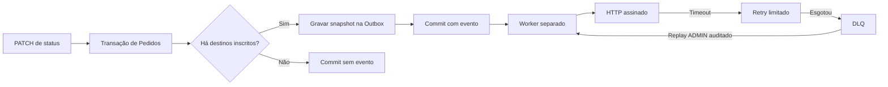

# FDD — Webhooks de mudança de status de pedidos

**Status** · Proposta técnica para revisão. As referências de integração descrevem a base atual e os fluxos descrevem o comportamento planejado.

## 1. Contexto e motivação técnica

- **FDD-CTX-01** — Clientes B2B querem substituir consultas periódicas por notificações outbound.
- **FDD-INT-01** — Aplicação modular TypeScript/Express compõe dependências manualmente e monta API em /api/v1. [app.ts](../src/app.ts) · [package.json](../package.json)
- **FDD-INT-02** — changeStatus lê, valida e grava status, histórico e estoque aplicável em transação Prisma. [order.service.ts](../src/modules/orders/order.service.ts)
- **FDD-INT-03** — Débito só em PENDING → PAID. [order.status.ts](../src/modules/orders/order.status.ts)
- **FDD-INT-04** — Cancelamento de PAID/PROCESSING repõe estoque. [order.status.ts](../src/modules/orders/order.status.ts)
- **FDD-INT-05** — Router e schema atuais não contêm rotas webhook, nem tabelas de outbox/DLQ; manifesto não tem script de worker. [index.ts](../src/routes/index.ts) · [schema.prisma](../prisma/schema.prisma) · [package.json](../package.json)
- **FDD-INT-06** — Schema usa provider MySQL e gera o cliente Prisma. [schema.prisma](../prisma/schema.prisma)

## 2. Objetivos técnicos

- **FDD-OBJ-01** — Meta de notificar em menos de 10 s.

## 3. Escopo e exclusões

- **FDD-ESC-01** — Excluir inbound.
- **FDD-ESC-02** — Escopo de emissão limitado às mudanças de status.
- **FDD-ESC-03** — Excluir itens do payload.
- **FDD-ESC-04** — Excluir email.
- **FDD-ESC-05** — Excluir dashboard.
- **FDD-ESC-06** — Descartar broker Redis para evitar infraestrutura extra.
- **FDD-ESC-07** — Descartar exactly-once pela coordenação exigida.
- **FDD-ESC-08** — Sem garantia de ordem global.
- **FDD-ESC-09** — Adiar múltiplos workers.
- **FDD-ESC-10** — Observar necessidade de rate limiting.
- **FDD-ESC-11** — Arquivamento adiado; cerca de 30 dias foi sugestão.

## 4. Desenho técnico da solução

- **FDD-MOD-01** — Organizar módulo webhooks com controller, service, repository, rotas e schemas.
- **FDD-MOD-02** — Criar um entry point para o worker separado da API e manter a lógica no módulo de webhooks.
- **FDD-MOD-03** — Seguir composição manual, classes e convenção ESM .js. [app.ts](../src/app.ts)
- **FDD-MOD-04** — Handlers propagam next(err). [order.controller.ts](../src/modules/orders/order.controller.ts)
- **FDD-MOD-05** — Passar o cliente da transação de `changeStatus` ao produtor, conforme a proposta `publishWebhookEvent(tx, order, fromStatus, toStatus)`.
- **FDD-DATA-01** — Schema atual usa camelCase, mapeamento de tabelas e UUID CHAR(36). [schema.prisma](../prisma/schema.prisma)
- **FDD-DATA-02** — Modelar cadastro com URL, segredo, customer_id e indicador ativo.
- **FDD-DATA-05** — Persistir snapshot imutável com UUID na mudança.
- **FDD-DATA-10** — Persistir falha em DLQ separada com payload, motivo e instante.
- **FDD-DATA-15** — Diego propôs índices por estado e criação para consultar as pendências mais antigas em lotes pequenos.
- **FDD-TX-11** — Evitar rede e segundo cliente/transação no publisher.

### Persistência e coordenação propostas

- **FDD-PROP-DADOS-01** — Persistir uma entrega por destino inscrito, com ID do evento, ID do destino, snapshot, estado, contador e próxima tentativa.
- **FDD-PROP-DADOS-02** — Usar a combinação evento e destino como chave única para evitar duplicação de registros no produtor.
- **FDD-PROP-WORK-01** — Reivindicar a entrega por atualização condicional; confirmar a posse antes de registrar o resultado. Executar HTTP fora da transação e tornar a reivindicação recuperável após interrupção.
- **FDD-PROP-DLQ-01** — Persistir o registro da DLQ e a transição para estado terminal na mesma transação. No replay, voltar a pendente e registrar a auditoria sem descartar o histórico de tentativas.

## 5. Fluxos detalhados

- **FDD-FLUXO-01** — PATCH /api/v1/orders/:id/status chama o controller de status. [app.ts](../src/app.ts) · [index.ts](../src/routes/index.ts) · [order.routes.ts](../src/modules/orders/order.routes.ts)
- **FDD-FLUXO-02** — Controller passa id, body e usuário ao serviço, devolvendo pedido atualizado. [order.controller.ts](../src/modules/orders/order.controller.ts)
- **FDD-FLUXO-03** — Mesmo status ou transição proibida gera erro no fluxo atual. [order.service.ts](../src/modules/orders/order.service.ts)
- **FDD-FLUXO-04** — Filtrar por cliente e status de destino na inserção; zero registros sem interessados.
- **FDD-FLUXO-05** — Falha de enqueue reverte status, histórico e estoque aplicável; HTTP ocorre após commit.
- **FDD-WORK-01** — Iniciar com um único worker em processo separado, independente dos reinícios da API.
- **FDD-WORK-02** — Consultar as pendências a cada dois segundos, começando pelas mais antigas.
- **FDD-WORK-03** — Ordem por pedido discutida para um único worker.
- **FDD-WORK-04** — Mesmo banco e DATABASE_URL, instância Prisma própria do processo.
- **FDD-WORK-05** — Larissa sugeriu `npm run worker` para iniciar o futuro processo de entregas.
- **FDD-WORK-09** — Aplicar timeout HTTP de 10 s e tratar como falha para retry.
- **FDD-RETRY-01** — Limitar a cinco tentativas totais por ciclo. Ao esgotar o limite sem sucesso, persistir a falha na DLQ.
- **FDD-RETRY-02** — A lista verbal de esperas foi 1 min, 5 min, 30 min, 2 h e 12 h. Ela diverge do total de cinco tentativas.
- **FDD-DLQ-02** — Replay manual retorna falha da DLQ à fila pendente.
- **FDD-DLQ-03** — Exigir ADMIN e registrar a identidade de quem pediu o replay.



## 6. Contratos públicos

- **FDD-API-11** — Cadastrar via POST com URL HTTPS, cliente explícito e status de interesse. A plataforma gera e devolve o segredo.
- **FDD-API-13** — Listar via GET os webhooks de um cliente explicitamente identificado.
- **FDD-API-15** — Editar via PATCH a configuração do destino, incluindo o filtro por status.
- **FDD-API-18** — Remover o cadastro via DELETE.
- **FDD-API-20** — Rotacionar o segredo pela API, com validade paralela do anterior por 24 h.
- **FDD-API-23** — Consultar `GET /webhooks/:id/deliveries` com payload, resultado, resposta disponível e tempo de resposta. A referência aos últimos 100 foi um exemplo.
- **FDD-API-26** — Solicitar replay em `POST /admin/webhooks/dead-letter/:id/replay`.
- **FDD-OUT-01** — O corpo JSON contém `event_id`, `event_type` (`order.status_changed`), `timestamp` ISO 8601, `order_id`, `order_number`, `from_status`, `to_status`, `customer_id` e `total_cents`.
- **FDD-OUT-02** — Enviar `X-Event-Id` (UUID do evento), `X-Webhook-Id` (ID do cadastro), `X-Timestamp` (instante do envio), `X-Signature` (HMAC) e `Content-Type: application/json`.
- **FDD-OUT-03** — Assinar corpo com HMAC-SHA256 e segredo por endpoint.
- **FDD-OUT-04** — X-Timestamp de envio não integra HMAC sobre o corpo.
- **FDD-OUT-05** — At-least-once e deduplicação por identidade de evento.
- **FDD-OUT-13** — Centavos inteiros e estados do enum OrderStatus atual. [schema.prisma](../prisma/schema.prisma)

### Contratos administrativos propostos para implementação

Os nomes de campos, paths adicionais e respostas abaixo são propostas. Os exemplos usam dados fictícios. Para cadastro e edição, a decisão da reunião exige HTTPS e filtro por status. Para replay, exige ADMIN e auditoria do autor.

- **FDD-PROP-HTTP-01** — Usar Authorization: Bearer, Content-Type: application/json para os corpos e base /api/v1 no router da aplicação.
- **FDD-PROP-HTTP-02** — Usar POST /api/v1/webhooks para cadastro e PATCH /api/v1/webhooks/:id para edição.
- **FDD-PROP-HTTP-03** — Cadastro recebe customerId, url e statuses, responde 201 com id e secret e falha com 400 para URL inválida.
- **FDD-PROP-HTTP-04** — Edição do filtro recebe statuses, responde 200 com id e filtro atualizado e retorna 404 se o cadastro não existir.
- **FDD-PROP-HTTP-05** — Usar POST /api/v1/webhooks/:id/rotate-secret, com confirmação explícita no corpo. Responder 200 com novo segredo e 404 se o cadastro não existir.
- **FDD-PROP-HTTP-06** — Replay recebe confirmação explícita, responde 202 com a entrega recolocada em pendente e retorna 403 se faltar o papel ADMIN. A resposta 202 indica aceitação, sem confirmação de entrega.

| Operação | Request JSON | Status de sucesso | Response JSON |
|---|---|---|---|
| `POST /api/v1/webhooks` | `{"customerId":"11111111-1111-4111-8111-111111111111","url":"https://example.com/pedidos","statuses":["SHIPPED"]}` | `201 Created` | `{"id":"22222222-2222-4222-8222-222222222222","secret":"<segredo-gerado>"}` |
| `PATCH /api/v1/webhooks/:id` | `{"statuses":["DELIVERED"]}` | `200 OK` | `{"id":"22222222-2222-4222-8222-222222222222","statuses":["DELIVERED"]}` |
| `POST /api/v1/webhooks/:id/rotate-secret` | `{"confirm":true}` | `200 OK` | `{"secret":"<novo-segredo>"}` |
| `POST /api/v1/admin/webhooks/dead-letter/:id/replay` | `{"confirm":true}` | `202 Accepted` | `{"status":"PENDING"}` |

### Exemplo ilustrativo de evento outbound

```json
{
  "event_id": "33333333-3333-4333-8333-333333333333",
  "event_type": "order.status_changed",
  "timestamp": "2026-11-26T12:00:00Z",
  "order_id": "66666666-6666-4666-8666-666666666666",
  "order_number": "ORD-000042",
  "from_status": "PROCESSING",
  "to_status": "SHIPPED",
  "customer_id": "11111111-1111-4111-8111-111111111111",
  "total_cents": 15000
}
```

## 7. Matriz de erros previstos

- **FDD-ERR-BASE** — Adotar prefixo WEBHOOK_ nos erros do módulo.
- **FDD-ERR-APP** — AppError informa mensagem, statusCode, errorCode e detalhes. [app-error.ts](../src/shared/errors/app-error.ts)
- **FDD-ERR-MW** — Middleware trata AppError/Zod/Prisma e fallback de erro inesperado. [error.middleware.ts](../src/middlewares/error.middleware.ts)
- **FDD-ERR-VALID** — Validação atual aplica Zod a body/query/params e usa erro genérico. [validate.middleware.ts](../src/middlewares/validate.middleware.ts)
- **FDD-ERR-AUTH** — Autenticação e papel têm erros genéricos atuais. [auth.middleware.ts](../src/middlewares/auth.middleware.ts)
- **FDD-ERR-PARSER** — express.json de 1 MB precede logger e router. [app.ts](../src/app.ts)
- **FDD-ERR-29** — Fallback de parser pode cair em INTERNAL_SERVER_ERROR quando erro não for AppError, Zod ou Prisma conhecido. [app.ts](../src/app.ts) · [error.middleware.ts](../src/middlewares/error.middleware.ts)
- **FDD-ERR-PROP-01** — WEBHOOK_NOT_FOUND e WEBHOOK_INVALID_URL foram sugeridos como nomes de erro do módulo.

| Código | Quando | Resposta ou ação proposta |
|---|---|---|
| `WEBHOOK_INVALID_URL` | URL inválida ou sem HTTPS | 400 |
| `WEBHOOK_NOT_FOUND` | Cadastro inexistente na edição ou rotação | 404 |
| `WEBHOOK_DELIVERY_TIMEOUT` | Destino não responde em 10 s | Retry ou DLQ se esgotado |
| `WEBHOOK_REPLAY_FORBIDDEN` | Usuário autenticado sem papel ADMIN | 403 |

- **FDD-PROP-ERR-01** — Mapear WEBHOOK_INVALID_URL para 400 e WEBHOOK_NOT_FOUND para 404 no contrato administrativo.
- **FDD-PROP-ERR-02** — Registrar timeout de entrega como WEBHOOK_DELIVERY_TIMEOUT.
- **FDD-PROP-ERR-03** — Mapear replay por usuário autenticado sem ADMIN para WEBHOOK_REPLAY_FORBIDDEN, com 403.

## 8. Estratégias de resiliência

O worker encerra a tentativa após 10 s sem resposta. A entrega volta ao processamento conforme o backoff e, ao esgotar o limite de cinco chamadas, segue para DLQ. A recuperação de uma falha esgotada é manual. A indisponibilidade do destino não altera pedidos já confirmados.

- **FDD-PROP-RET-01** — Para implementação inicial, propor 1 min, 5 min, 30 min e 2 h entre as quatro retentativas após a chamada inicial. O intervalo de 12 h da reunião permanece pendente de decisão.
- **FDD-PROP-RET-02** — Interpretar 2xx como sucesso e disponibilizar classificação de falhas HTTP e de transporte para revisão antes de estabilizar a política de retry.

- **FDD-RISCO-01** — Escrever outbox fora do tx perde garantia entre mudança e intenção.
- **FDD-RISCO-03** — Consumidor indisponível pode esgotar retry e requerer replay.

## 9. Segurança

- **FDD-API-01** — CRUD via JWT com qualquer role autenticada.
- **FDD-API-02** — AuthUser possui id, email e role; authenticate usa Bearer e requireRole confere papel. [auth.middleware.ts](../src/middlewares/auth.middleware.ts)
- **FDD-API-03** — Schema não liga usuários a clientes. [schema.prisma](../prisma/schema.prisma)
- **FDD-API-04** — Registro público aceita ADMIN e preserva papel no serviço. [auth.routes.ts](../src/modules/auth/auth.routes.ts) · [auth.schemas.ts](../src/modules/auth/auth.schemas.ts) · [auth.controller.ts](../src/modules/auth/auth.controller.ts) · [auth.service.ts](../src/modules/auth/auth.service.ts) · [user.service.ts](../src/modules/users/user.service.ts) · [user.repository.ts](../src/modules/users/user.repository.ts)
- **FDD-SEG-01** — Exigir HTTPS e validar com schema.
- **FDD-SEG-10** — Pedido referencia Customer e usuário criador; histórico de status referencia o usuário autor. [schema.prisma](../prisma/schema.prisma)
- **FDD-API-32** — Usar requireRole existente para replay.

## 10. Observabilidade

- **FDD-API-10** — Middleware atual reflete ou cria X-Request-Id. [request-logger.middleware.ts](../src/middlewares/request-logger.middleware.ts)
- **FDD-OBS-01** — Pino e redação de campos conhecidos já existem. [index.ts](../src/shared/logger/index.ts)
- **FDD-OBS-02** — Logger HTTP próprio acrescenta ID e registra duração. [request-logger.middleware.ts](../src/middlewares/request-logger.middleware.ts)
- **FDD-OBS-03** — Manifesto não declara SDK de métricas ou tracing dedicado; pino-http consta como dependência. [package.json](../package.json)
- **FDD-OBS-08** — AppError não é logado automaticamente no ramo correspondente. [error.middleware.ts](../src/middlewares/error.middleware.ts)

### Instrumentação proposta

- **FDD-PROP-OBS-01** — Métricas: medir duração entre commit e primeira entrega bem-sucedida e acompanhar volume de pendências, falhas finais e retries.
- **FDD-PROP-OBS-02** — Logs: registrar início e resultado da tentativa, ida à DLQ e replay auditado. Usar Pino e omitir segredo e payload integral.
- **FDD-PROP-OBS-03** — Tracing: correlacionar alteração de pedido, registro da outbox e envio pelo ID do evento, mantendo a correlação após reinício e replay. Avaliar o mecanismo de exportação.

## 11. Dependências e compatibilidade

- **FDD-WORK-12** — Bootstrap atual da API chama process.exit após desconectar Prisma no shutdown. [server.ts](../src/server.ts)
- **FDD-DEP-01** — O manifesto declara Node.js ≥20, Express 4.21.1, Prisma 5.22.0, Zod 3.23.8, Pino 9.5.0, uuid 11.0.3, Vitest 2.1.4 e Supertest 7.0.0. [package.json](../package.json)
- **FDD-DEP-03** — Loader Zod valida ambiente e encerra em configuração inválida; carrega banco, JWT, porta e logging. [env.ts](../src/config/env.ts)
- **FDD-DEP-04** — Schema declara SHADOW_DATABASE_URL. [schema.prisma](../prisma/schema.prisma)
- **FDD-DEP-07** — Fábrica e singleton de PrismaClient existentes. [database.ts](../src/config/database.ts)
- **FDD-DEP-13** — Compose configura MySQL local. [docker-compose.yml](../docker-compose.yml)

## 12. Integração com o sistema existente

- **FDD-API-06** — Schema e API de Pedidos usam nomes camelCase e IDs UUID, como referência de convenção. [schema.prisma](../prisma/schema.prisma) · [order.schemas.ts](../src/modules/orders/order.schemas.ts)
- **FDD-API-07** — Padrão de paginação de pedidos usa page >= 1 e pageSize de 1 a 100, com padrões 1 e 20. [order.schemas.ts](../src/modules/orders/order.schemas.ts)
- **FDD-API-08** — Helpers padronizam envelope data/pagination. [response.ts](../src/shared/http/response.ts)
- **FDD-DEP-15** — OrderRepository concentra leitura com relações e transação de listagem. [order.repository.ts](../src/modules/orders/order.repository.ts)
- **FDD-DEP-16** — Router agrega controllers e rotas dos módulos atuais. [index.ts](../src/routes/index.ts)
- **FDD-DEP-17** — Setup de teste usa Prisma e limpa tabelas em ordem referencial antes de cada teste. [setup.ts](../tests/setup.ts)
- **FDD-INT-08** — OrderService.create cria o pedido PENDING com histórico de criação. [order.service.ts](../src/modules/orders/order.service.ts)
- **FDD-INT-09** — O projeto já oferece GET /api/v1/orders/:id para consulta detalhada. [app.ts](../src/app.ts) · [index.ts](../src/routes/index.ts) · [order.routes.ts](../src/modules/orders/order.routes.ts)

| Arquivo existente | Integração planejada |
|---|---|
| [src/modules/orders/order.service.ts](../src/modules/orders/order.service.ts) | Em `changeStatus`, chamar o produtor dos eventos elegíveis com o `tx` atual antes do commit. |
| [prisma/schema.prisma](../prisma/schema.prisma) | Acrescentar os modelos de configuração, entrega pendente e falha terminal no schema MySQL. |
| [src/routes/index.ts](../src/routes/index.ts) | Montar as rotas de cadastro e operação sem mudar as rotas de Pedidos. |
| [src/shared/errors/app-error.ts](../src/shared/errors/app-error.ts) | Usar o contrato `AppError` para transmitir código e status ao middleware central. |
| [src/middlewares/auth.middleware.ts](../src/middlewares/auth.middleware.ts) | Aplicar `requireRole` no endpoint administrativo de replay e manter autenticação nas operações de cadastro. |

- **FDD-PROP-INTEG-01** — Adicionar ao schema os modelos de configuração, entrega pendente e DLQ e montar as novas rotas no router existente.

## 13. Estratégia de testes

- **FDD-TESTE-01** — Testes atuais usam Vitest/Supertest, buildApp com Prisma, MySQL e factories. [orders.test.ts](../tests/orders.test.ts) · [setup.ts](../tests/setup.ts) · [factories.ts](../tests/helpers/factories.ts)
- **FDD-TESTE-02** — Vitest configura arquivos sem paralelismo e forks/singleFork. [vitest.config.ts](../vitest.config.ts)

## 14. Critérios de aceite técnicos

- **FDD-AC02** — Falha da persistência de evento elegível reverte status, histórico e estoque aplicável.
- **FDD-AC03** — Sem interessados, zero registros e mudança válida confirmada.
- **FDD-AC05** — Consumidor offline não bloqueia mudança; worker envia fora da transação.
- **FDD-AC07** — HMAC valida corpo original e falha após adulteração.
- **FDD-AC14-AUD** — Apenas ADMIN executa replay e autor é auditado.

## 15. Riscos e mitigação

- **FDD-TX-03** — Validação e decremento de estoque são etapas distintas, sem trava explícita nessa leitura. [order.service.ts](../src/modules/orders/order.service.ts)
- **FDD-PLAN-01** — Sofia solicitou pelo menos dois dias úteis de revisão de segurança antes do deploy.
- **FDD-PLAN-02** — Três sprints com revisão e prazo da Atlas a confirmar.
- **FDD-RISC-07** — Fluxo de status e fluxo de exclusão leem e depois escrevem sem trava explícita na leitura. [order.service.ts](../src/modules/orders/order.service.ts) · [order.repository.ts](../src/modules/orders/order.repository.ts)

- **FDD-PROP-RISCO-01** — Mitigar duplicação após interrupção do worker preservando o ID do evento em tentativas repetidas e exercitando recuperação com um consumidor de teste.

## 16. Questões em aberto

- **FDD-DATA-07** — Qual será a cardinalidade entre evento e entrega por destino, com quais chaves e índices?
- **FDD-TX-04** — Como o worker reivindicará trabalho, recuperará execução interrompida e evitará confirmações concorrentes?
- **FDD-RETRY-03** — Como conciliar o total de cinco tentativas com os cinco intervalos verbalizados, incluindo 12 h?
- **FDD-RETRY-04** — Quais respostas HTTP e falhas de rede permitem retry, confirmam sucesso ou encerram o ciclo?
- **FDD-RETRY-08** — Como retry e replay interagem com ordem por pedido, identidade do evento e preservação do snapshot?
- **FDD-DLQ-06** — Como evitar replays administrativos concorrentes para a mesma falha?
- **FDD-API-05** — Como corrigir a atribuição de ADMIN e estabelecer isolamento por cliente?
- **FDD-API-12** — Quais paths, DTOs, status HTTP e paginação devem ser adotados onde a reunião definiu somente a operação?
- **FDD-API-17** — Qual destino usar em tentativas pendentes após edição e como tratar desativação e remoção?
- **FDD-OUT-12** — Qual método HTTP usar no envio outbound?
- **FDD-SEG-04** — Como gerar, armazenar, recuperar e rotacionar os segredos e representar a coexistência de assinaturas no wire?
- **FDD-SEG-06** — Quais destinos e políticas de saída serão permitidos após a revisão de Segurança?
- **FDD-DATA-14** — Como interpretar 64 KB em bytes e qual resposta dará a API de Pedidos em caso de excesso?
- **FDD-OBS-06** — Como medir latência e falhas e correlacionar origem, entrega e replay usando observabilidade aprovada?
- **FDD-TESTE-10** — Quais fixtures, cenários de concorrência, carga e ambiente de homologação devem ser adotados?

## Documentos relacionados

- [Transcrição da reunião](../TRANSCRICAO.md) · [Tracker](TRACKER.md) · [PRD](PRD.md) · [RFC](RFC.md).

