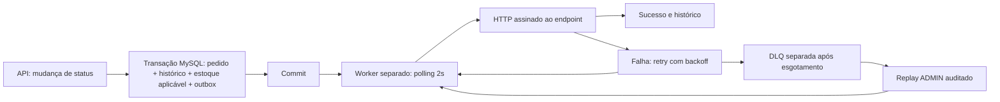

# RFC — Webhooks de mudança de status de pedidos

**Autora:** Larissa (Tech Lead) · **Status:** proposta para revisão · **Data:** 16/11/2026

**Revisores (participantes da reunião):** Larissa (Tech Lead), Marcos (Product Manager), Bruno (Pedidos), Diego (Plataforma) e Sofia (Segurança).

## Resumo executivo (TL;DR)

Outbox transacional MySQL e worker separado entregarão mudanças de status por HTTP assinado, com deduplicação pelo consumidor, retry limitado e DLQ. A proposta reutiliza Prisma e a infraestrutura existente. A meta é notificar em menos de dez segundos; rate limiting, retenção e escala permanecem em aberto.

## 1. Contexto e objetivo

Atlas Comercial, MaxDistribuição e Nova Cargo querem substituir consultas periódicas a `GET /orders`, lentas e custosas, por notificações outbound. A Atlas sinalizou risco de migração para concorrente ([transcrição](../TRANSCRICAO.md), [09:00–09:02]). A confirmação do pedido deve independer da disponibilidade do destinatário.

O monólito modular REST TypeScript/Express usa Prisma/MySQL e transaciona status, histórico e estoque; o débito ocorre em `PENDING → PAID`. Webhooks, outbox, worker e DLQ ainda não existem, conforme os relatórios de [arquitetura](reports/architectural-analyzer/architectural-report-2026-11-11_20-40-00.md) e [Pedidos](reports/component-deep-analyzer/component-analysis-orders-2026-11-11_20-40-00.md).

**Critério de leitura:** escolhas confirmadas, propostas dos ADRs e pendências são distintas. Os sete ADRs estão **Propostos**, inclusive MySQL/Prisma retrospectivos; aprovação e implementação não são atestadas. Suas datas civis não são comprovadas pela transcrição.

## 2. Escopo e requisitos confirmados

- **Configuração:** cadastrar, editar, remover e listar webhooks por cliente, com URL, estado ativo e filtro de status. Segredo gerado e devolvido na criação, com rotação. Qualquer role autenticada pode operar o CRUD; `customer_id` vem do body ou path, não do JWT.
- **Notificação:** filtrar inscrições pelo status de destino na inserção; sem interessados, não registrar entrega. Capturar snapshot com UUID na mudança.
- **Consulta e recuperação:** histórico de entregas para diagnóstico e replay manual de DLQ por ADMIN, com auditoria do autor. Endpoints e paginação pertencem ao FDD.
- **Segurança e limites:** HTTPS obrigatório; HMAC-SHA256 sobre o corpo com segredo por endpoint; rotação com coexistência de 24 horas; payload de até 64 KB, com erro ao exceder, sem truncamento; timeout HTTP de dez segundos, seguido de tratamento de falha.

Email de fallback e dashboard visual ficam fora desta fase. Adiamentos operacionais constam da seção 5.

## 3. Solução arquitetural

### Persistência e fronteira transacional

**Confirmado na reunião:** gravar outbox e snapshot na transação de status; falha na escrita causa rollback. O HTTP ocorre após o commit ([ADR-003](adrs/ADR-003-outbox-mysql-na-transacao-de-status.md)). O snapshot preserva o significado do evento diante de mudanças posteriores.

**Proposta do ADR-003:** separar evento imutável e entregas por endpoint na mesma transação, permitindo recuperação independente dos destinos.

Reutilizam-se [MySQL](adrs/ADR-001-mysql-como-banco-relacional.md) e [Prisma](adrs/ADR-002-prisma-para-acesso-a-dados.md): base da outbox e do worker, que sustenta o retry.

### Processamento, entrega e recuperação

**Confirmado na reunião:** iniciar com um worker independente, Prisma próprio e banco compartilhado, em polling de dois segundos ([ADR-006](adrs/ADR-006-worker-separado-com-polling.md)). Aceita-se ordem por pedido com um worker, sem ordem global; a interação com retries permanece em aberto.

**Proposta dos ADRs 004/006:** bloquear entregas posteriores do mesmo pedido/destino durante a recuperação da anterior. O trade-off é maior latência; replay pode chegar fora de ordem. Interrupção após envio e antes da confirmação no banco pode gerar duplicata.

**Confirmado na reunião:** aceitar duplicatas, deduplicadas pelo consumidor com `X-Event-Id` ([ADR-004](adrs/ADR-004-entrega-http-at-least-once-com-event-id.md)); retry limitado a cinco tentativas totais, incluindo o envio inicial, e DLQ separada, preservando payload, motivo e timestamp ([ADR-007](adrs/ADR-007-retry-com-backoff-e-dlq.md)). Retries finitos não garantem recepção por destino permanentemente indisponível.

**Proposta dos ADRs 004/007:** preservar identidade e snapshot em retries e replay. O quinto intervalo permanece em revisão (seção 5).

### Contrato e segurança

Contrato JSON enxuto, campos, headers e endpoints ([transcrição](../TRANSCRICAO.md), [09:43–09:45]) serão detalhados no FDD, com persistência, coordenação, classificação de falhas e reprocessamento.

O [ADR-005](adrs/ADR-005-hmac-sha256-com-segredo-por-endpoint.md) propõe formato da assinatura e gestão dos segredos, sujeitos à revisão de segurança. O timestamp não integra o HMAC; sua idade não oferece proteção autenticada contra replay. A prevenção de reaplicação depende da deduplicação. Não há evidência de conclusão da revisão solicitada a Sofia.

### Integração com os padrões existentes

**Confirmado na reunião:** seguir a organização modular e reutilizar validação, logging e tratamento de erros. Estrutura de arquivos, funções e assinaturas pertencem ao FDD; os novos campos sensíveis exigem proteção.

## 4. Alternativas descartadas

| Alternativa discutida | Justificativa e trade-off da escolha |
|---|---|
| HTTP síncrono na mudança de status | Cliente lento prolongaria a transação; falha externa não deve impedir confirmação do pedido. Outbox adiciona processamento e operação assíncrona. |
| Redis Streams | Infraestrutura adicional considerada excessiva para a equipe. MySQL reduz operação nova, mas concentra carga e disponibilidade. |
| Trigger para notificar o processo externo | A discussão não identificou comunicação externa nativa adequada; exigiria mecanismo adicional. Polling aceita espera e consultas periódicas. |
| Worker no processo da API | Acoplaria processamento aos reinícios da API. Processo separado exige operação e conexões próprias. |
| Exactly-once | Coordenação entre produtor e consumidor considerada complexa. A escolha transfere deduplicação ao cliente. |
| Retry indefinido ou apenas três tentativas | O primeiro deixa eventos pendurados; três foram considerados insuficientes para manutenção de duas horas. Retry limitado exige intervenção após esgotamento. |
| Falha apenas na própria outbox | DLQ separada foi preferida para clareza da leitura, investigação e replay, ao custo de outro conjunto de dados a operar. |
| Segredo global; renderização do payload no envio | Segredo global amplia impacto de vazamento; renderização tardia pode refletir estado posterior. Segredo individual e snapshot exigem gestão e armazenamento adicionais. |

## 5. Questões em aberto

### Pendências e adiamentos registrados na reunião

- **Rate limiting de saída:** observar e decidir depois, sem política definida nesta fase ([transcrição](../TRANSCRICAO.md), [09:38–09:39]).
- **Retenção e arquivamento:** a sugestão de arquivar após “30 dias ou assim” ficou fora do escopo, sem política fechada ([transcrição](../TRANSCRICAO.md), [09:08]).
- **Escala e ordenação:** múltiplos workers foram adiados; particionamento e locks foram citados como possibilidades futuras ([transcrição](../TRANSCRICAO.md), [09:12–09:13]).

### Lacunas e ambiguidades identificadas na análise

Os pontos abaixo não foram explicitamente registrados como pendências pelos participantes:

1. **Retry e ordenação:** a reunião registra “total 5 tentativas” e enumera cinco esperas. O desenho aplica as quatro primeiras. Revisar o intervalo de 12 h e validar a interação entre recuperação e ordem.
2. **Autorização:** definir isolamento por `customer_id`. O [relatório de autenticação](reports/component-deep-analyzer/component-analysis-auth-2026-11-11_20-40-00.md) registra autoatribuição pública de ADMIN; `requireRole` isoladamente não assegura a restrição do replay.
3. **Segurança do contrato:** revisar segredos e deduplicação; definir proteção contra destinos na rede interna, não assegurada apenas por HTTPS.
4. **Capacidade e observabilidade:** definir volume e medição de atraso, falhas e DLQ; validar a meta de latência.
5. **Ciclo de vida dos dados:** definir retenção de outbox/DLQ/histórico, efeito de editar, desativar ou excluir endpoints sobre pendências e tratamento de payload acima de 64 KB na transação.

## 6. Impacto e riscos

- **Operação e capacidade:** banco compartilhado recebe mais escritas e polling; outro processo exige operação. Backlog, envios e bloqueios de ordenação podem comprometer a meta de latência, ainda sem validação de desempenho.
- **Entrega e recuperação:** esgotamento exige intervenção; replay após expirar a deduplicação pode reaplicar efeitos.
- **Segurança e dados:** autoatribuição de ADMIN compromete a restrição do replay. Snapshot, histórico e DLQ exigem retenção e proteção.
- **Consistência:** outbox condiciona o commit, mas não elimina os riscos de concorrência em status/estoque inferidos pelo relatório de Pedidos; eventos podem refletir transições incorretas.

Relatórios estáticos não validam carga, runtime, disponibilidade ou dimensionamento de produção.

## 7. Decisões relacionadas

| ADR | Relação com a proposta |
|---|---|
| [ADR-001 — MySQL](adrs/ADR-001-mysql-como-banco-relacional.md) | Base relacional reutilizada pela outbox. |
| [ADR-002 — Prisma](adrs/ADR-002-prisma-para-acesso-a-dados.md) | Acesso a dados e composição da transação. |
| [ADR-003 — Outbox transacional](adrs/ADR-003-outbox-mysql-na-transacao-de-status.md) | Atomicidade entre pedido e intenção de notificação. |
| [ADR-004 — Entrega e identidade](adrs/ADR-004-entrega-http-at-least-once-com-event-id.md) | Duplicatas e deduplicação pelo consumidor. |
| [ADR-005 — HMAC e segredos](adrs/ADR-005-hmac-sha256-com-segredo-por-endpoint.md) | Autenticidade, integridade e rotação. |
| [ADR-006 — Worker separado](adrs/ADR-006-worker-separado-com-polling.md) | Processamento independente por polling. |
| [ADR-007 — Retry e DLQ](adrs/ADR-007-retry-com-backoff-e-dlq.md) | Recuperação limitada e replay administrativo. |

## 8. Revisão e encaminhamento

Larissa revisará o design com Bruno e Diego antes da codificação. Sofia solicitou pelo menos dois dias úteis para revisão de segurança antes do deploy. Três sprints, incluindo revisão, e fim de novembro para a Atlas são planejamento verbal, a confirmar por Marcos. A revisão deve resolver pendências e deliberar sobre os ADRs.
